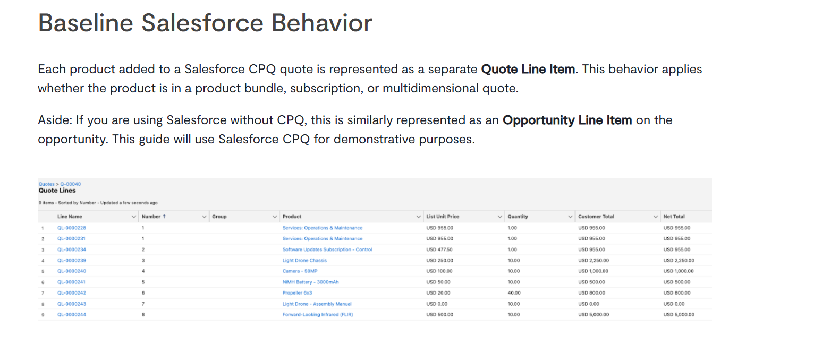
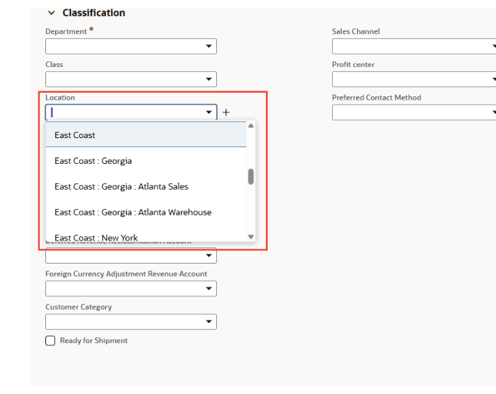
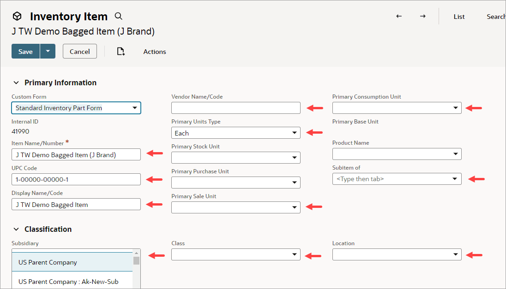
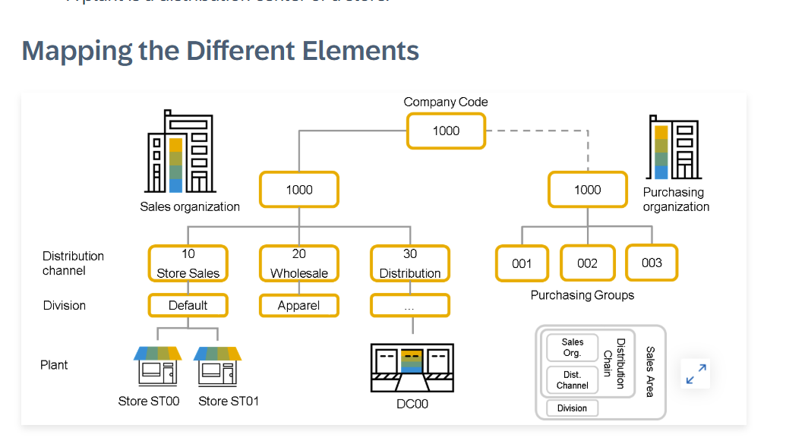
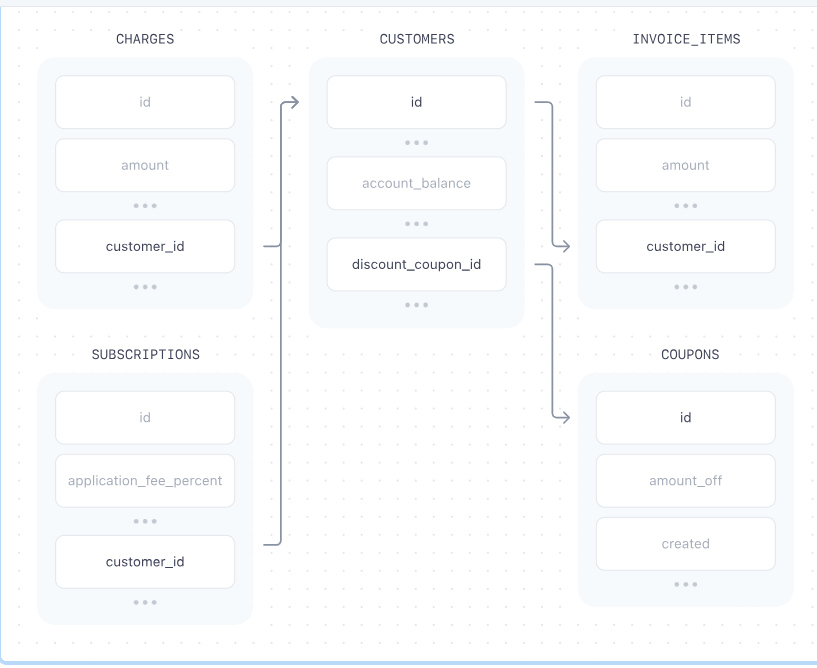

[Marcoms MSD 2026](../../Marcoms%20MSD%202026.md) > [Dự án Đồng bộ hệ thống_Data Sync - 05.2026](../Dự%20án%20Đồng%20bộ%20hệ%20thống_Data%20Sync%20-%2005.2026.md)

# Báo cáo cài đặt Service ID\_Data Sync\_20/5/2026

# Tổng kết

Sau báo cáo phân tích ở dưới, có 3 điểm em rút ra được khi triển khai Service ID mới cho công ty

- Không nhúng country vào service ID
- Không nhúng new/renewal vào service ID
- Để quản trị dịch vụ đầy đủ, nên đi từ Department → xác định rõ cụ thẻ các Service đầy đủ nhất + Bổ sung 3 trường theo dõi mới là Market, Company, Billing type (dịch vụ duy trì hay dịch vụ 1 lần duy nhất - này QBO có triển khai bên lisence để thông báo gia hạn)

# Phân tích chi tiết

## Nghiên cứu từ top công ty đầu ngành cung cấp CRM quản trị vể tạo Product ID và Service ID

> [!IMPORTANT]
> Điểm chung của các công ty cung cấp: **Tên sản phẩm là độc lập không gồm country, renewal. Tạo các trường mô tả khác tách biệt để theo dõi theo nhu cầu**

| Platform |  | Mô tả Service ID | **Có bao gồm country trong service ID?** | Có bao gồm Renewal trong Service ID | **Rút ra được gì?** |
| --- | --- | --- | --- | --- | --- |
| **Salesforce CPQ** |  | Product mô tả theo nhu cầu | Quản trị theo Market riêng biệt, không để chung | Subscription type là field riêng (Term, Renewal\_Type) | Dùng subscription type để phân loại báo giá |
| **Oracle NetSuite** |  | Item mô tả theo nhu cầu | Quản trị theo location tách khỏi Item   Quản trị theo subsidiary (công ty) tách khỏi Item | Có thêm Item Type: Service vs Subscription,      Có thêm trường Period để làm rõ thời gian duy trì | 1 service code dùng được cho tất cả entity   Dùng Period và Serviceo type để phân loại dịch vụ sản phẩm cung cấp 1 lần và dịch vụ cung cấp hằng năm |
| **SAP S/4HANA** |  | Material mô tả theo nhu cầu | Quản trị theo Sales Organization & Distribution Channel — không bao giờ trong service code | Contract Type (one-time vs recurring) là master data riêng | Tách cột sales organization riêng biệt để dễ theo dõi |
| **Stripe Billing** |  | Product mô tả theo nhu cầu | Currency trong Price, không trong Product | Price type: one\_time / recurring (interval: month/year) | Cột price linh hoạt, không cố định hoạt cố định theo quy tắc thị trường phân phối để quản lý   Ví dụ: 1 service linh hoạt theo báo giá tự phát triển hoặc cố định cho thị trường Singapore, Mỹ, H |

## Nghiên cứu cách đặt tên Product ID và Service ID

### So sánh tổng quan giữa 3 cách đặt tên Service ID

> [!IMPORTANT]
> Service ID độc lập, với 5 trường bổ sung sẽ dễ dàng hơn để triển khai và quản trị

| Tiêu chí | **Service ID hiện tại, giữ nguyên không đổi** | **Service ID bao gồm country, rewwal, đầy đủ cho tất cả dịch vụ** | **Service ID độc lập, không gồm country, renweal** |
| --- | --- | --- | --- |
| Ví dụ | Company incorporation package in the US | Company incorporation package in the US   Company incorporation package in the US Renewal |  |
| **Số lượng service entries** | 221+, tăng theo nhu cầu và mức độ dịch vụ sẵn sàng | 1890+ dịch vụ cần triển khai mới | 100 service cố định, cụ thể của từng team |
| **Thêm dịch vụ** | Thêm theo nhu cầu cần thiết   Ví dụ: Cung cấp Candy Mỹ, | + N số lượng dịch vụ tương ứng cho mỗi quốc gia, loại dịch vụ   Ví dụ: Canada + thêm 15 dịch vụ tương ứng tạo sẵn | Chỉ thêm vài dịch vụ mới cố định   Ví dụ: Phần mềm Candy |
| **Thêm thị trường mới** | Tạo mới Service ID tương ứng | Tạo mới Service ID tương ứng | Không cần tạo mới, chỉ cần thêm quốc gia mới vào trường Country |
| **Theo dõi theo thị trường** | Cần lọc theo tên service ID có sẵn | Cần lọc theo tên country trong tên Service ID | Chỉn cần lọc theo cột Country |
| **Theo dõi gia hạn** | Cần lọc theo tên Service ID có sẵn | Cần lọc theo tên Service ID có sẵn | Chỉ cần lọc theo cột billing type |
| **Tích hợp vào Bonus calculation** | Cần tham khảo Service ID sẵn có | Cần tham khảo Service ID sẵn có | Chỉ cần lọc theo country, và service type đã có sẵn |

## Đề xuất triển khai

| **Cấp độ theo dõi** | Tên | Số lượng đề xuất | Ví dụ | Lợi ích |
| --- | --- | --- | --- | --- |
| **Tầng 1** | Department   (Quản trị theo team dịch vụ trước) | 6 | Consulting, Tax-Accounting, Banking, IT, Legal, Marcoms | Theo dõi đc   P&L by department, Team bonus |
| **Tầng 2** | Service   (Từ team dịch vụ, xác định rõ các dịch vụ trọng điểm của team hiện có | 100 | Company Incorporation, Company Renewal, QBO License, Trademark Registration | Theo dõi được   Revenue by service, |
| **Tầng 3** | Attributes (Theo dõi theo 3 trường ) | 3 | Market, Company, billing type | Phân tích theo 3 góc nhìn khsc nhau |

Ví dụ áp dụng dự kiến cho GLAC

Bảng rút gọn

| **Orgganization Number** | **Client ID** | **Invoice No** | **Service** | **Market** | **Department** | **Company** | **Quantity** | **Quote Price (Gia báo)** | **Final Pay (số tiền thanh toán)** | **Billing type** | **Invoice Date** |
| --- | --- | --- | --- | --- | --- | --- | --- | --- | --- | --- | --- |
| CRM100 | G2605-4241 | <mark style="background: #ffffff;">INV-20260478</mark> | Thành lập công ty | Singapore | Incorporation | GLAC | 1 | 100 | 100 | One-off | 1/4/2026 - 1/4/2027 |
| CRM100 | G2605-4241 | INV-20260478 | Thuế kế toán | Hong Kong | Tax Accounting | GLAC | 1 | 100 | 100 | Renewal | 1/4/2026 - 1/4/2027 |
| CRM100 | G2605-4241 | INV-20260478 | QuickBooks lisence | Mỹ | QuickBooks | GLAD | 1 | 100 | 100 | One-off | 1/4/2026 - 1/4/2027 |

Bảng chi tiết

<https://drive.globallinkconsulting.sg/oo/r/18JZ4HjC1mPnKBifjq3VPqmDzkqMBLqR#tid=5>

## Nguồn dữ liệu

Service ID đề xuất v1 <https://drive.globallinkconsulting.sg/oo/r/186CGp3asNrTFcTWeMaR5k7wYkmZo7rl#tid=5>

Đề xuất đồng bộ Service ID giữa Quotation Tool - Jira - CRM

[Page not accessible (ID: 5425233972)]
