[Marcoms MSD 2026](../../Marcoms%20MSD%202026.md) > [Phát triển tool viết bài 05.2026](../Phát%20triển%20tool%20viết%20bài%2005.2026.md)

# \[Review\] Tổng hợp đánh giá - Tool Viết bài tự động - 02.06.2026

- [VERSION 1: Tổng hợp review của team MarCom (Soạn ngày 02.06.2026)](#id-reviewtổnghợpđánhgiá-toolviếtbàitựđộng-02062026-version1tổnghợpreviewcủateammarcomsoạnngày02062026)

  - [Chú thích ký hiệu:](#id-reviewtổnghợpđánhgiá-toolviếtbàitựđộng-02062026-chúthíchkýhiệu)- [Bảng 1: Các nhận xét chi tiết từng bước trong Trợ lý AI Viết bài tự động](#id-reviewtổnghợpđánhgiá-toolviếtbàitựđộng-02062026-bảng1cácnhậnxétchitiếttừngbướctrongtrợlýaiviếtbàitựđộng)
  - [Bảng 2: Đánh giá điểm số SEO On-page của bài viết được tạo bởi trợ lý AI](#id-reviewtổnghợpđánhgiá-toolviếtbàitựđộng-02062026-bảng2đánhgiáđiểmsốseoon-pagecủabàiviếtđượctạobởitrợlýai)
    - [Đối với bài viết EN của Daniel testing:](#id-reviewtổnghợpđánhgiá-toolviếtbàitựđộng-02062026-đốivớibàiviếtencủadanieltesting)
    - [Đối với bài viết VI của Winnie testing:](#id-reviewtổnghợpđánhgiá-toolviếtbàitựđộng-02062026-đốivớibàiviếtvicủawinnietesting)
  - [Bảng 3: Góp ý khác về giao diện phần mềm](#id-reviewtổnghợpđánhgiá-toolviếtbàitựđộng-02062026-bảng3gópýkhácvềgiaodiệnphầnmềm)
- [VERSION 2: Cung cấp các thông tin (Cập nhật ngày 08.06.2026)](#id-reviewtổnghợpđánhgiá-toolviếtbàitựđộng-02062026-version2cungcấpcácthôngtincậpnhậtngày08062026)
  - [Bảng tài khoản phần mềm liên quan (Cập nhật ngày 08.06.2026)](#id-reviewtổnghợpđánhgiá-toolviếtbàitựđộng-02062026-bảngtàikhoảnphầnmềmliênquancậpnhậtngày08062026)

> [!IMPORTANT]
> # **VERSION 1: Tổng hợp review của team MarCom (**Soạn ngày 02.06.2026)
>
> Gửi anh Tony Ho, chị Hong Anh
>
> Page tổng hợp review của team MarCom (Daniel & Winnie) khi thực hiện testing Trợ lý Viết bài bằng AI

|  | **Bài viết test** | **Thời gian thực hiện** | **Được thực hiện bởi** |
| --- | --- | --- | --- |
| 1 | <http://192.168.1.15:8080/desk/article-job/sg-general-202606-030> <br/> Topic: Should you acquire a shelf company overseas? <mark style="background: #cce0ff;">BÀI TIẾNG ANH</mark> | Ngày 01.06.2026 <br/> 11:17 | Daniel [\[Review\] Tool Viết bài tự động\_Daniel\_28.05.2026](_Review_%20Tổng%20hợp%20đánh%20giá%20-%20Tool%20Viết%20bài%20tự%20động%20-%2002.06.2026/_Daniel%20Review%2028.05_%20Tool%20Viết%20bài%20tự%20động_Daniel_28.05.2026.md) |
| 2 | <http://192.168.1.15:8080/desk/article-job/us-incorporation-202605-029> <br/> Topic: Thành lập công ty E-commerce tại Mỹ cho doanh nghiệp Việt <mark style="background: #f8e6a0;">BÀI TIẾNG VIỆT</mark> | Ngày 25.08.2026 | Winnie [\[Review\] Tool viết bài tự động\_Winnie\_27.05.2026](_Review_%20Tổng%20hợp%20đánh%20giá%20-%20Tool%20Viết%20bài%20tự%20động%20-%2002.06.2026/_Winnie%20Review%2027.05_%20Tool%20viết%20bài%20tự%20động%20-%2027.05.2026.md) |

> [!NOTE]
> ### Chú thích ký hiệu:
>
> - Các text màu đỏ đề cập đến tên 1 trường cụ thể trong giao diện, ví dụ:
>
>   - **<font style="color: #ff5630;">Competitor Source</font>**: ở bước 2 - Researcher
> - Các text có highlight màu xanh thể hiện điểm mới, chưa có trong Sheet quy trình ban đầu, ví dụ:
>
>   - <mark style="background: #c6edfb;">(điểm mới - chưa đề cập trong Sheet quy trình) </mark>
> - PIC: là human (Daniel/Winnie)

## Bảng 1: Các nhận xét chi tiết từng bước trong Trợ lý AI Viết bài tự động

|  |  | <mark style="background: #b3f5ff;">**Daniel đánh giá cụ thể** <mark style="background: #cce0ff;">BÀI TIẾNG ANH</mark></mark> | <mark style="background: #fff0b3;">**Winnie đánh giá cụ thể** <mark style="background: #f8e6a0;">BÀI TIẾNG VIỆT</mark></mark> | **Tóm tắt chỉnh sửa** | **Chấm điểm** |
| --- | --- | --- | --- | --- | --- |
| 1 | **Tổng thời gian thực hiện** | <mark style="background: #e6fcff;">Nhanh (12 - 20 phút) cho 1 bài viết hoàn chỉnh</mark> | <mark style="background: #fffae6;">Nhanh (10 - 20 phút) cho 1 bài viết hoàn chỉnh</mark> | -- | 10/10 |
| 2 | **Bước 1: Chat với PR Assistant để tạo bài viết** | <mark style="background: #e6fcff;">Không có vấn đề <br/>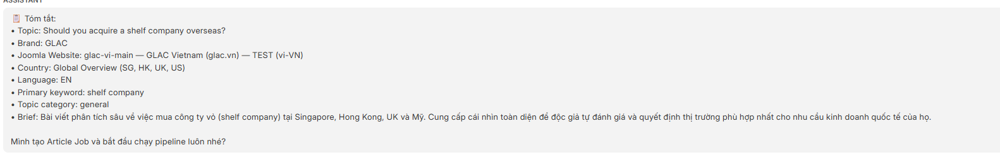</mark> | <mark style="background: #fffae6;">Không có vấn đề</mark> | -- | 10/10 |
| 3 | **Bước 2: Researcher** | <mark style="background: #e6fcff;">✅ **Các điểm đạt yêu cầu:** <br/>- Reseach toàn diện từ các nguồn: <br/>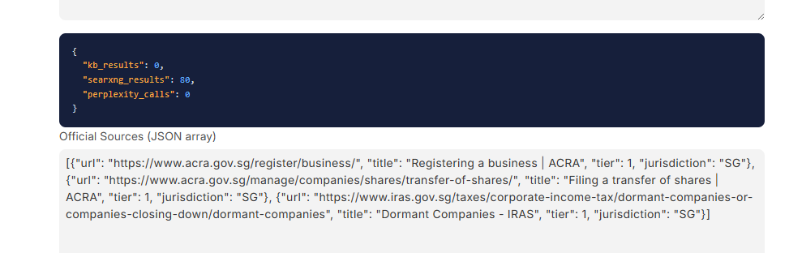- chính phủ, tổ chức uy tín <br>- các công ty đối thủ trên Google <br>- social media (LinkedIn) <br/>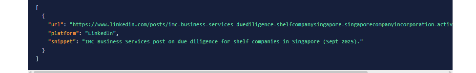<br>- Nghiên cứu bằng tiếng Anh chất lượng kết qua tốt hơn tiếng việt, do source gốc nhiều tư liệu để đối chiếu và tham khảo <br>- Phần content gap rất hay, giúp gợi ý bổ sung thêm FAQs hoặc làm sâu nội dung  ❌ **Điểm cần cải thiện:** <br/>**Cho phép Researcher nghiên cứu nhiều hơn 1 thị trường (<font style="color: #ff5630;">Country Code</font>):** Yêu cầu của PIC và thống nhất với PR Assistant về thị trường là SG - HK - UK - US, nhưng kết quả AI ở bước này chỉ research 1 thị trường SG <br/>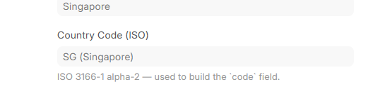</mark> | <mark style="background: #fffae6;">✅ **Các điểm đạt yêu cầu:** <br/>Research từ các nguồn: <br/>- chính phủ: Có liên quan đến nội dung bài viết <br>- đối thủ cạnh tranh: Chưa liên quan đến nội dung bài viết *(chi tiết bên dưới)* <br/>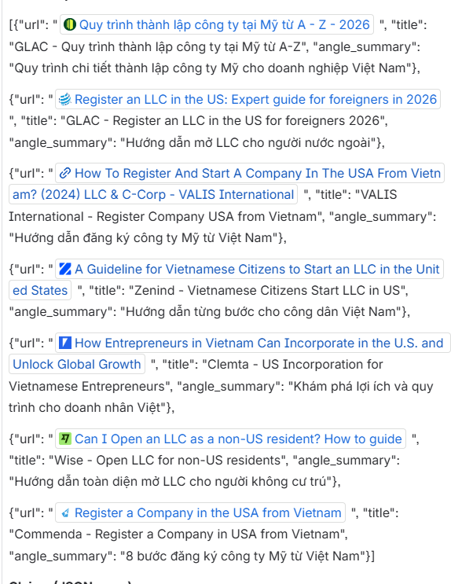 ❌ **Điểm cần cải thiện:** <br/>- **Cần Researcher cung cấp <font style="color: #ff5630;">Competitor Source</font> từ các website của công ty cùng lĩnh vực có thứ hạng cao trên Google & liên quan đến Keyword của bài viết:** <mark style="background: #c6edfb;">(điểm mới - chưa đề cập trong Sheet quy trình) </mark> <br/>Ví dụ với từ khóa **“set up an e-commerce company in the US**“ (từ khóa translate thị trường VI: thành lập công ty thương mại điện tử tại mỹ), danh sách website mà Researcher nên đề xuất là: <br/>- <https://stripe.com/resources/more/how-to-start-an-ecommerce-business-the-right-way-from-setup-to-growth> <br>- <https://www.uschamber.com/co/start/startup/online-e-commerce-business-guide> <br>- <https://www.reddit.com/r/ecommerce/comments/1fbffid/seeking_advice_on_starting_an_ecommerce_business/> <br>- <https://currenxie.com/company/articles-and-guides/setting-up-an-ecommerce-store-us> <br>- <https://www.entrepreneur.com/building-a-business/online-presence/how-do-i-set-up-an-ecommerce-business> <br/>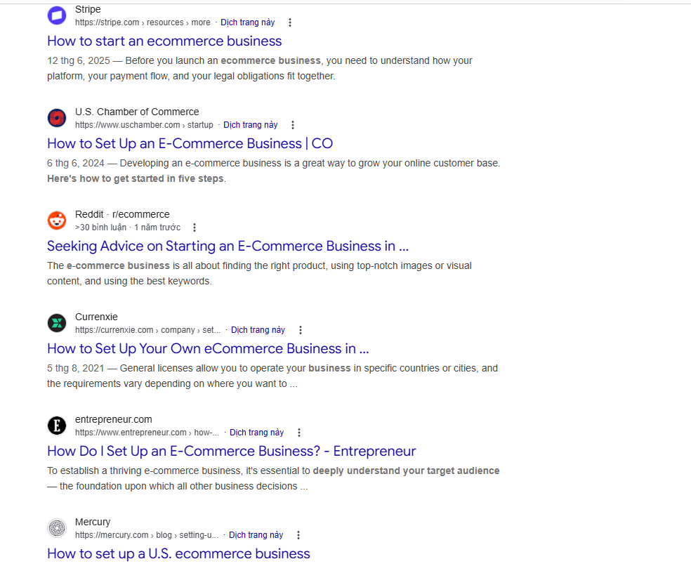<br>- **Researcher cần cung cấp <font style="color: #ff5630;">Source của Claims</font> từ các nguồn chính phủ hay cơ quan có thẩm quyền:** hiện tại Source of Claims là từ các trang web của một doanh nghiệp cùng lĩnh vực, việc này khiến PIC phải thủ công kiểm tra lại thông tin trong các Claim có thực sự chính xác không. <br/>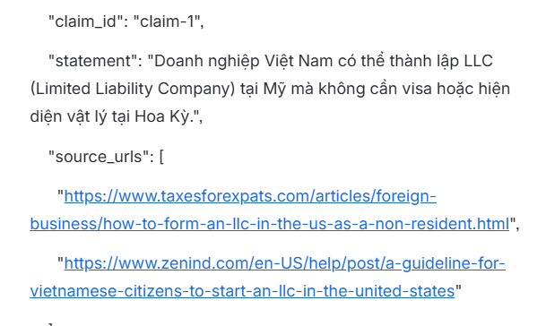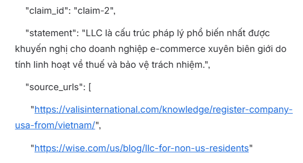<br>- **<font style="color: #ff5630;">Key Insight</font> cần được đưa ra một cách thực tế và có phát hiện mới từ các thông tin đã research**, thay vì tóm tắt lại thông tin. Key Insight có thể theo format chung như: <mark style="background: #c6edfb;">(điểm mới - chưa đề cập trong Sheet quy trình) : </mark> <br/>từ Keyword research, insight có thể rút ra về: <br/>- **khó khăn** đối với **chủ thể** (công ty E-commerce) và **hành động** (Thành lập công ty ở mỹ) được cập trong keyword <br>- **thủ tục** cần thực hiện sau khi đã thực hiện **hành động** (thành lập công ty ở Mỹ) <br>- “mục đích thực hiện”, “…”<br/><details><br/><summary>Key insight từ Researcher cung cấp</summary><br/><br/>“Doanh nghiệp Việt Nam ngày càng chuyển sang mô hình thành lập LLC tại Mỹ để tiếp cận thị trường e-commerce lớn nhất thế giới. LLC là lựa chọn tối ưu nhờ chi phí thấp ($132 trung bình), thủ tục đơn giản (không cần hiện diện vật lý), và lợi thế thuế pass-through. Wyoming và New Mexico là tiểu bang tiết kiệm nhất để duy trì LLC, trong đó Delaware được ưa chuộng cho doanh nghiệp có tham vọng lớn. Thuế bán hàng theo cơ chế economic nexus (Wayfair) và marketplace facilitator laws là yếu tố then chốt cần hiểu rõ. Việc tuân thủ Form 5472 là bắt buộc và mức phạt $25,000 cho vi phạm là rủi ro đáng kể. Ngân hàng fintech Mercury/Wise/Relay giúp giải quyết bài toán tài khoản ngân hàng Mỹ từ xa.” <br/> → Đây là tóm tắt thông tin, không phải Key Insight. Toàn bộ nội dung đều là thông tin research, không có phát hiện mới, không có góc nhìn đặc thù cho Ecommerce, và không chỉ ra được điều gì doanh nhân Việt Nam đang hiểu sai hoặc chưa biết về chủ đề “thành lập công ty thương mại điện tử tại Mỹ” <br/> → (Winnie) Key insight có thể là: Thành lập công ty Ecommerce tại Mỹ không khó, phần khó là những gì xảy ra sau đó mà không ai nói trước: **không nhận được tiền, không biết nghĩa vụ khai báo, và đang ra quyết định dựa trên những câu hỏi sai.** <br/><br/><br/></details><br/><br/>Cần xác định **<font style="color: #ff5630;">Content Gaps</font>** được đưa ra tự động đã dựa trên cơ sở nào?</mark> | - Cho phép Researcher nghiên cứu **nhiều hơn 1** **thị trường (****<font style="color: #ff5630;">Country Code</font>****)**<br>- Cần Researcher cung cấp **<font style="color: #ff5630;">Competitor Source</font>** từ các website của công ty cùng lĩnh vực có thứ hạng cao trên Google & liên quan đến Keyword của bài viết <mark style="background: #c6edfb;">(điểm mới - [ ] chưa đề cập trong Sheet quy trình) </mark><br>- Researcher cần cung cấp**<font style="color: #ff5630;">Source của Claims</font>** từ các nguồn chính phủ hay cơ quan có thẩm quyền<br>- Giao diện thuần kỹ thuật IT, cần nâng cấp giao diện thân thiện hơn với người dùng team MarCom  <br/> ❓ Thắc mắc: **<font style="color: #ff5630;">Content Gaps</font>** được đưa ra tự động đã dựa trên những cơ sở nào? |  |
| 4 | **Bước 3: Strategist** | <mark style="background: #e6fcff;">✅ **Các điểm đạt yêu cầu:** <br/>3 góc nhìn để phân tích + AI đề xuất ban đầu để hiểu vì sao chọn góc nhìn nào  ❌ **Điểm cần cải thiện (đề xuất):** để tăng tính thuyết phục hơn cho 3 angels và giảm thiểu thời gian chỉnh sửa ở bước Drafter cho PIC <br/>Đính kèm 3 outline bài viết ở 3 angle để PIC có thêm cơ sở lựa chọn 1 Angel phù hợp bên cạnh AI đề xuất.</mark> | <mark style="background: #fffae6;">✅ **Các điểm đạt yêu cầu:** <br/>Strategist đưa ra 03 angles, phân tích, lý do và đề xuất rất thuyết phục, chấp nhận được.</mark> | Đính kèm 3 outline bài viết ở 3 **<font style="color: #ff5630;">angle </font>**để PIC có thêm cơ sở lựa chọn 1 Angel phù hợp bên cạnh AI đề xuất. |  |
| 5 | **Bước 4: Drafter** | <mark style="background: #e6fcff;">❌ **Điểm cần cải thiện:** <br/>- PIC có thể chỉnh trực tiếp **<font style="color: #ff5630;">Outline</font>** của bài viết để nội dung bài viết được tạo ra tốt hơn ở các bước tiếp theo. <br/>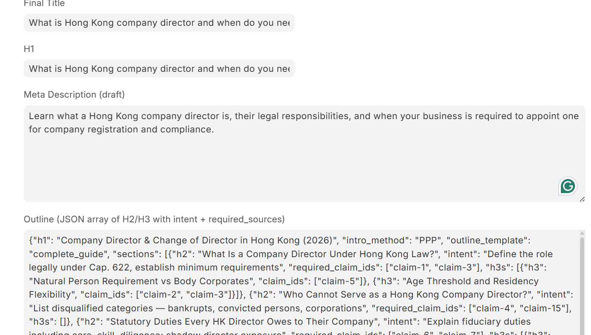<br>- Cho phép thay đổi các yêu cầu (**<font style="color: #ff5630;">Outline Template</font>**, **<font style="color: #ff5630;">Intro Method</font>**) và tạo lại Drafter: <br/>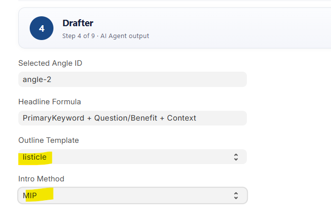</mark> | <mark style="background: #fffae6;">❌ **Điểm cần cải thiện:** <br/>Cho phép PIC duyệt hoặc điều chỉnh **<font style="color: #ff5630;">Outline</font>**/**<font style="color: #ff5630;">Heading</font>** trước khi DONE bước Drafter, bao gồm các công việc: <br/>1. Điều chỉnh thêm/xóa nội dung trong **<font style="color: #ff5630;">Heading</font>** (nhằm mục đích tối ưu từ khóa, tối ưu ý nghĩa heading)<br>2. Thêm mới các heading (H2, H3) vào **<font style="color: #ff5630;">Outline</font>**</mark> | - Cho phép thay đổi các yêu cầu về mẫu outline, công thức viết bài (**<font style="color: #ff5630;">Outline Template</font>**, **<font style="color: #ff5630;">Intro Method</font>**) và cho phép tạo lại Drafter<br>- Cho phép PIC duyệt hoặc điều chỉnh **<font style="color: #ff5630;">Outline</font>**/**<font style="color: #ff5630;">Heading</font>** trước khi DONE bước Drafter |  |
| 6 | **Bước 5: QC Gate** | <mark style="background: #e6fcff;">✅ **Các điểm đạt yêu cầu:** <br/>Phần mềm chỉ ra các điểm cần người sử dụng đối chiếu lại như: kiểm tra thông tin fact check penalty từ site chính phủ đúng hay không</mark> | <mark style="background: #fffae6;">✅ **Các điểm đạt yêu cầu:** <br/>QC Gate phát hiện được vấn đề về thông tin cần được kiểm tra lại, và hướng dẫn writter **tự kiểm tra** và **tự sửa** các thông tin. <br/>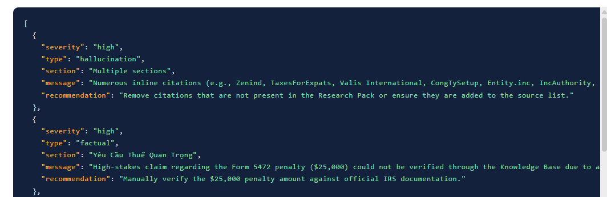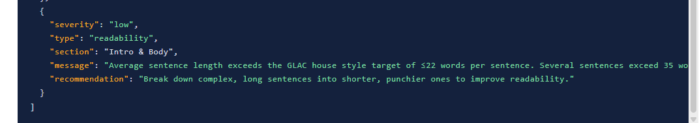 ❌ **Điểm cần cải thiện:** <br/>Các các lỗi **<font style="color: #ff5630;">Issue </font>**mà QC Gate chỉ ra được, PIC thực hiện thao tác chỉnh sửa như thế nào, ở bước nào?</mark> | ❓ **Thắc mắc:** Các các **<font style="color: #ff5630;">Issue </font>**mà QC Gate chỉ ra được, PIC thực hiện thao tác chỉnh sửa như thế nào, ở bước nào? |  |
| 7 | **Bước 6: Brand Proof** | <mark style="background: #e6fcff;">✅ **Các điểm đạt yêu cầu:** <br/>Giao diện tương dối dễ nhìn, chia làm các phần chính mà team có thể xem như Title, Meta, Slug (URL), article mardown (Body), FAQ. CTA (Conclusion)  ❌ **Điểm cần cải thiện:** <br/>- Nên dùng từ vựng và cấu trúc câu tiếng Anh ở mức độ B1-B2: Cách dùng từ hơi AI, chưa tự nhiên và dễ hiểu như người dùng <br>- Cách dùng từ EN chưa thực sự phù hợp với Brand proof (hạn chế dùng các collacation và idiom vì khi dịch ra tiếng Việt có thể AI dịch không sát nghĩa tiếng Việt), ví dụ: <br/>- “the sweeping transparency” - Hơi văn nói <br>- “This openness drives much of Hong Kong's appeal among Southeast Asian entrepreneurs constructing offshore platforms. Accessibility nonetheless pairs with enforceable accountability.” <br/> → Có thể viết đơn giản hơn là: <br/> “Hong Kong’s business-friendly environment attracts many Southeast Asian entrepreneurs looking to expand internationally. But that flexibility comes with clear rules and strong accountability.”<br>- Xóa các nguồn nội dung không chính thống (ví dụ nguồn từ công ty đối thủ, công ty cùng lĩnh vực)</mark> | <mark style="background: #fffae6;">❌ **Điểm cần cải thiện:** <br/>- Văn phong và Nội dung cần đảm bảo theo chuẩn Content Guideline của GLAC. **Các lỗi mắc phải của AI là:** <br/>- Về văn phong: <br/>- Giọng văn có hướng giống 1 blogger; <br>- Các câu văn không có chủ ngữ, vị ngữ rõ ràng (giống 1 câu CTA hơn) <br>- Sử dụng từ “bạn“ xuyên suốt trong toàn bài → Sai content guideline của GLAC; <br>- Sử dụng cụm từ “Chúng tôi“ → Sai content guideline của GLAC (chuẩn là Global Link Asia Consulting, “GLAC”, Chuyên gia GLAC…); <br>- Sử dụng cụm từ “**hàng chục** doanh nghiệp“ → Làm giảm uy tín thương hiệu (chuẩn là *hơn 1000 doanh nghiệp)* <br>- Sử dụng lẫn lộn tiếng anh trong bài viết tiếng việt; <br>- Thiếu nội dung trích dẫn chuyên gia như file Content Guideline có nhắc đến, không có case study<br>- Về format nội dung: <br/>- Heading dùng Title Case viết hoa mọi từ, sai quy tắc content guideline article <br>- Không nên sử dụng quá nhiều câu đơn ngắn liên tiếp, mỗi câu chỉ có một ý, đứng rời rạc nhau. Cách viết này khiến nội dung bị vụn, thiếu mạch logic kết nối giữa các ý, và không thể hiện được chiều sâu phân tích của một bài viết chuyên gia<br>- Output content cần đa dang cách trình bày hơn ví dụ như dạng Bullet points hoặc dạng Bảng</mark> | Đối với bài tiếng Anh: <br/>- câu văn cần đơn giản, dễ hiểu, và human<br>- sử dụng cấu trúc câu và từ vựng ở mức độ B1 - [ ] B2<br>- hạn chế sử dụng idiom hoặc collocation<br>- xóa các trích nguồn nội dung không chính thống, chỉ để lại các nguồn từ chính phủ, văn bản luật Đối với bài tiếng Việt: <br/>- Nội dung đảm bảo content guideline của website<br>- Đảm bảo nội dung bài viết cần có các định dạng sau: Danh sách / Bullet point, Bảng<br>- Đoạn văn bao gồm chủ chủ ngữ - [ ] vị ngữ, theo cấu trúc diễn dịch rõ ràng.<br>- Đảm bảo ngôn ngữ được sử dụng trong bài viết (vi hay là en), tránh sử dụng lẫn lộn tiếng anh trong bài viết tiếng việt hoặc ngược lại<br>- Sử dụng trích dẫn nguồn từ chính phủ/ hay cơ quan có thẩm quyền<br>- Hyperlink trích dẫn phải dẫn đến URL chính xác của trang tài liệu gốc thay vì dùng tên domain chung.<br>- Xóa các trích nguồn nội dung không chính thống, chỉ để lại các nguồn từ chính phủ, văn bản luật |  |
| 8 | **Bước 7: Image Brief** | <mark style="background: #e6fcff;">Chưa thể đánh giá vì chưa có hình ảnh output <br/>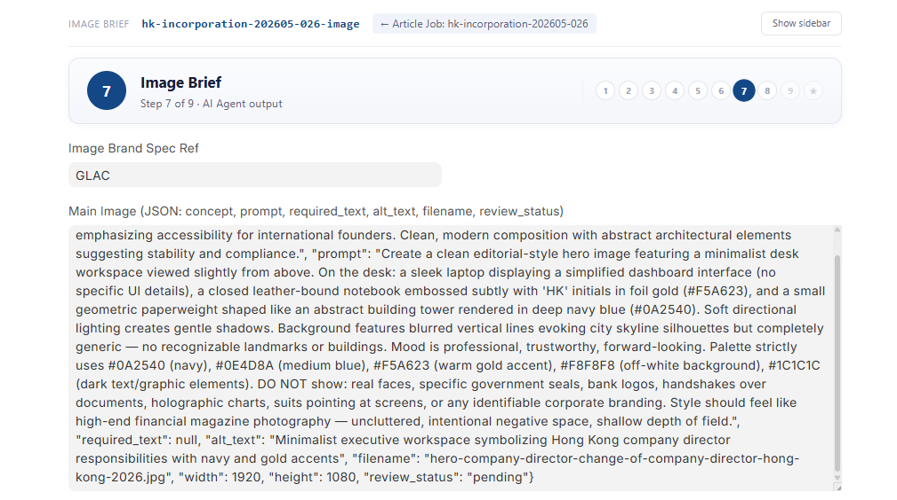</mark> | <mark style="background: #fffae6;">Chưa có nhận xét</mark> |  |  |
| 9 | **Bước 8: Formatter** | <mark style="background: #e6fcff;">✅ Các điểm đạt được: <br/>Giao diện dễ nhìn, HTML có thẻ sử dụng được  ❌ **Điểm khó khăn:** <br/>Cần bổ sung 1 giao diện song song để Preview và Editiable (giống Candy OCR): để cập nhật, sửa lỗi bài viết trước khi chuyển qua bước Joomla Sink cuối.</mark> | <mark style="background: #fffae6;">❌ **Điểm khó khăn:** <br/>Cần bổ sung giao diện preview để người dùng có thể xem bài viết ở định dạng hiển thị thực tế, đúng như khi bài được đăng lên website thay vì phải đọc qua code hay dạng Markdown.</mark> | Cần bổ sung 1 giao diện song song để Preview và Editiable (giống Candy OCR) |  |
| 10 | **Bước 9: Joomla Sink** | <mark style="background: #e6fcff;">Chưa có bình luận <br/> Chưa thấy button để Publish</mark> | <mark style="background: #fffae6;">--</mark> | -- |  |

## Bảng 2: Đánh giá điểm số SEO On-page của bài viết được tạo bởi trợ lý AI

### Đối với bài viết EN của Daniel testing:

| <mark style="background: #f0f1f2;">**Tiêu chí**</mark> | <mark style="background: #f0f1f2;">&nbsp;</mark> | <mark style="background: #f0f1f2;">**Đạt?**</mark> | <mark style="background: #f0f1f2;">**Note**</mark> |
| --- | --- | --- | --- |
| <mark style="background: #ffffff;">Title</mark> | <mark style="background: #ffffff;">Title < 70 ký tự <br/> Title chứa từ khóa chính</mark> | <mark style="background: #ffffff;">Đạt</mark> | <mark style="background: #ffffff;">"shelf company in Singapore" có mặt</mark> |
| <mark style="background: #ffffff;">URL</mark> | <mark style="background: #ffffff;">URL chuẩn (chữ thường, gạch ngang)</mark> | <mark style="background: #ffffff;">Đạt</mark> | <mark style="background: #ffffff;">should-you-buy-a-shelf-company-in-singapore n</mark> |
| <mark style="background: #ffffff;">Meta description</mark> | <mark style="background: #ffffff;">150 ký tự</mark> | <mark style="background: #ffffff;">Đạt</mark> | <mark style="background: #ffffff;">146 ký tự, chứa từ khóa chính & CTA <br/> Tuy nhiên nội dung cũng cần chỉnh lại</mark> |
| <mark style="background: #ffffff;">H1</mark> | <mark style="background: #ffffff;">Chứa từ khóa chính</mark> | <mark style="background: #ffffff;">Đạt</mark> | <mark style="background: #ffffff;">"Should You Buy a Shelf Company in Singapore?" <br/> → Cần chỉnh lại thành Viết hoa chữ đầu + Singapore , còn lại viết thường</mark> |
| <mark style="background: #ffffff;">Keyword</mark> | <mark style="background: #ffffff;">Keyword phụ & ngữ nghĩa có mặt</mark> | <mark style="background: #ffffff;">Đạt</mark> | <mark style="background: #ffffff;">Có "company formation", "fresh incorporation" <br/> — "</mark> |
| <mark style="background: #ffffff;">Cấu trúc H2</mark> | <mark style="background: #ffffff;">Cấu trúc H2–H3 theo logic bài viết</mark> | <mark style="background: #ffffff;">Đạt</mark> | <mark style="background: #ffffff;">7 H2 rõ ràng, luận điểm tuyến tính hợp lý <br/> **Không có H3 nào —** cấu trúc phẳng, thiếu phân tầng</mark> |
| <mark style="background: #ffffff;">Link nội bộ</mark> | <mark style="background: #ffffff;">Link nội bộ 1–3 trang dịch vụ + bài viết</mark> | <mark style="background: #ffffff;">Thiếu</mark> | <mark style="background: #ffffff;">Không thấy link nội bộ nào trong nội dung bài</mark> |
| <mark style="background: #ffffff;">Link ngoài</mark> | <mark style="background: #ffffff;">Link ngoài ≥ 1–3 link uy tín</mark> | <mark style="background: #ffffff;">Thiếu</mark> | <mark style="background: #ffffff;">Nguồn được trích (OneIBC, ACRA, IRAS) nhưng không cólink thực sự trong bài <br/> → Hạn chế đi link tới đối thủ.</mark> |
| <mark style="background: #ffffff;">Mở bài</mark> | <mark style="background: #ffffff;">Từ khóa chính trong 100 từ đầu <br/> 2–3 câu nêu giá trị người đọc nhận được <br/> Đoạn dẫn vào thân bài, nêu bật chuyên gia & mục tiêu</mark> | <mark style="background: #ffffff;">Thiếu</mark> | <mark style="background: #ffffff;">Có từ khóa <br/> Có mô tả lợi ích <br/> Tuy nhiên thiếu câu dẫn vào bài viết</mark> |
| <mark style="background: #ffffff;">Thân bài</mark> | <mark style="background: #ffffff;">Mỗi H2 có đoạn mở đầu tóm tắt ý chính <br/> Dùng đúng dàn ý, không trùng lặp</mark> | <mark style="background: #ffffff;">&nbsp;</mark> | <mark style="background: #ffffff;">Phần lớn H2 có, nhưng một số heading vào thẳng list mà không có câu dẫn <br/> Ko trùng ý, logic rõ ràng</mark> |
| <mark style="background: #ffffff;">&nbsp;</mark> | <mark style="background: #ffffff;">Mỗi đoạn 1 ý chính, 2–4 câu. <br/> Câu khoảng 20–24 từ, đủ chủ-vị-bổ</mark> | <mark style="background: #ffffff;">Cần chỉnh</mark> | <mark style="background: #ffffff;">Câu văn tiếng Anh nhưng có xu hướng dài & phức tạp — ví dụ: 'Overall timeline projections therefore overstate convenience substantially because...' (hơn 30 từ)</mark> |
| <mark style="background: #ffffff;">&nbsp;</mark> | <mark style="background: #ffffff;">Có giải thích, ví dụ, số liệu cụ thể (PREP) <br/> Có góc nhìn chuyên gia <br/> Tính chính xác — tránh từ tuyệt đối, có nguồn</mark> | <mark style="background: #ffffff;">Cần chỉnh <br/>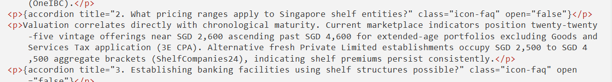</mark> | <mark style="background: #ffffff;">Có số liệu: SGD 2,600–4,600, 31% gặp vấn đề, 82% thực hiện due diligence, n <br/> Giọng văn chuyên gia nhưng thiếu trích dẫn hoặc khẳng định "theo kinh nghiệm tư vấn..." <br/> Tuy nhiên nguồn dẫn tới từ đối thủ nhiều (cần hạn chế)</mark> |
| <mark style="background: #ffffff;">&nbsp;</mark> | <mark style="background: #ffffff;">Không sai chính tả, ngữ pháp <br/> Thuật ngữ chuyên ngành chính xác, nhất quán</mark> | <mark style="background: #ffffff;">&nbsp;</mark> | <mark style="background: #ffffff;">KYC, AML, ACRA, BizFile+, dormant — dùng chuẩn và nhất quán <br/> Bài tiếng Anh — không phát hiện lỗi rõ ràng</mark> |
| <mark style="background: #ffffff;">Kết bài</mark> | <mark style="background: #ffffff;">Tóm tắt giá trị chính <br/> CTA tự nhiên, không bán hàng lộ liễu <br/> Mô tả uy tín & kinh nghiệm chuyên gia hỗ trợ</mark> | <mark style="background: #ffffff;">Thiếu</mark> | <mark style="background: #ffffff;">Có "Strategic Recommendation" nhưng ngắn và chung chung thiếu recap các điểm đã trình bày\] <br/> Có CTA nhưng còn chung chung <br/> Chưa mô tả điểm mạnh của GLAC</mark> |
| <mark style="background: #ffffff;">Độ dễ đọc</mark> | <mark style="background: #ffffff;">Sử dụng bullet, numbered list, table <br/> Từ ngữ dễ hiểu + thuật ngữ chuyên môn</mark> | <mark style="background: #ffffff;">Thiếu</mark> | <mark style="background: #ffffff;">Có dùng bullet point, nhưng ko có table, phải thêm thủ công <br/> Dùng từ ngữ vẫn còn phức tạp, cấu trúc câu phức nhiều</mark> |

### Đối với bài viết VI của Winnie testing:

| <mark style="background: #f0f1f2;">**Yếu tố**</mark> | <mark style="background: #f0f1f2;">**Chi tiết**</mark> | <mark style="background: #f0f1f2;">**Winnie check**</mark> |
| --- | --- | --- |
| <mark style="background: #ffffff;">Title</mark> | <mark style="background: #ffffff;">Ngắn gọn (<70 ký tự) Chứa 1 từ khóa SEO chính xác + mục tiêu bài viết</mark> | <mark style="background: #ffffff;">&nbsp;</mark> |
| <mark style="background: #ffffff;">Keyword chính</mark> | <mark style="background: #ffffff;">Chứa ít nhất 1 từ khóa chính</mark> | <mark style="background: #ffffff;">&nbsp;</mark> |
| <mark style="background: #ffffff;">Keyowrd phụ</mark> | <mark style="background: #ffffff;">Chứa ít nhất 1 từ khóa phụ (Secondary keyword) Chứa ít nhất 1 từ khóa ngữ nghĩa (Semantic keyword)</mark> | <mark style="background: #ffffff;">&nbsp;</mark> |
| <mark style="background: #ffffff;">URL</mark> | <mark style="background: #ffffff;">Chứa từ khóa chính hình thức chuẩn: abc-def (không viết hoa, viết liền, chứa ký tự kỳ lạ)</mark> | <mark style="background: #ffffff;">&nbsp;</mark> |
| <mark style="background: #ffffff;">Meta Description</mark> | <mark style="background: #ffffff;">Chứa từ khóa chính xác, từ khóa liên quan  Khoảng 150 ký tự</mark> | <mark style="background: #ffffff;">&nbsp;</mark> |
| <mark style="background: #ffffff;">H1</mark> | <mark style="background: #ffffff;">Chứa 1 từ khóa chính + mục tiêu bài viết</mark> | <mark style="background: #ffffff;">&nbsp;</mark> |
| <mark style="background: #ffffff;">Cấu trúc H2-H3</mark> | <mark style="background: #ffffff;">Cấu trúc H2/H3 theo logic mục tiêu bài viết Cấu trúc phân tầng hợp lý ( H3 trong H2, H4 trong H3) Mỗi H2/H3 là một câu hỏi rõ ràng</mark> | <mark style="background: #ffffff;">&nbsp;</mark> |
| <mark style="background: #ffffff;">Cấu trúc link nội bộ</mark> | <mark style="background: #ffffff;">"1-3 link tới trang dịch vụ cùng chủ đề,  1-3 link tới bài viết cùng chủ đề  Link đi có dạng /vi/…/alias/, để chết độ follow, current window Từ khóa neo phù hợp</mark> | <mark style="background: #ffffff;">Chưa có</mark> |
| <mark style="background: #ffffff;">Cấu trúc link đi ngoài</mark> | <mark style="background: #ffffff;">Ít nhất 1-3 link đi ngoài Link đi có dạng nguyên bảng: https:// Để chế độ follow với các link chính phủ, wiki, website uy tín Để chế độ nofollow cho các website khác, file PDF</mark> | <mark style="background: #ffffff;">Chưa có</mark> |
| <mark style="background: #ffffff;">Mở bài</mark> | <mark style="background: #ffffff;">Đi thẳng vào vấn đề, nêu giá trị bài viết người đọc sẽ nhận được Có 2-3 câu giải thích người đọc nhận được gì từ bài viết</mark> | <mark style="background: #ffffff;">&nbsp;</mark> |
| <mark style="background: #ffffff;">Thân bài</mark> | <mark style="background: #ffffff;">Triển khai rõ ràng từng ý, không lặp, không nhảy ý Mỗi H2 giải quyết 1 nhóm ý</mark> | <mark style="background: #ffffff;">Chưa đầy đủ</mark> |
| <mark style="background: #ffffff;">Kết bài</mark> | <mark style="background: #ffffff;">Tóm tắt ý chính, Call to action tự nhiên, không bán hàng lộ liễu ( Soft, contextual selling)</mark> | <mark style="background: #ffffff;">Chưa có CTA</mark> |
| <mark style="background: #ffffff;">Độ dài câu</mark> | <mark style="background: #ffffff;">Hạn chế câu dài, nhiều mệnh đề Mỗi câu có đầy đủ chủ ngữ - động từ - vị ngữ (Bổ ngữ). Mỗi câu khoảng 20-24 từ</mark> | <mark style="background: #ffffff;">**❌** <br/> Quá nhiều câu đơn 1 mệnh đề ngắn liên tiếp</mark> |
| <mark style="background: #ffffff;">Độ dài đoạn</mark> | <mark style="background: #ffffff;">Mỗi đoạn 1 ý chính  Mỗi đoạn bao gồm 2-4 câu</mark> | <mark style="background: #ffffff;">**❌** <br/> Nhiều đoạn chỉ có 1 câu, Một số đoạn tách ý không cần thiết</mark> |
| <mark style="background: #ffffff;">Tính mạch lạc</mark> | <mark style="background: #ffffff;">Ý sau nối ý trước Dùng câu chuyển ý</mark> | <mark style="background: #ffffff;">**❌** <br/> Thiếu câu chuyển ý giữa các section</mark> |
| <mark style="background: #ffffff;">Tinh đầy đủ</mark> | <mark style="background: #ffffff;">Bao quá đầy đủ nội dung dàn ý Không bỏ sót nội dung quan trọng</mark> | <mark style="background: #ffffff;">&nbsp;</mark> |
| <mark style="background: #ffffff;">Tính chính xác</mark> | <mark style="background: #ffffff;">Không dùng thông tin thiếu căn cứ,  Tránh từ tuyệt đối nếu không có chứng minh rõ ràng (Nguồn đảm bảo tính chính thống, dùng các nguồn từ chính phủ gov, tổ chức uy tín org, công ty nghiên cứu thị trường, ) Không dùng từ có thể để tránh sự mơ hồ Luôn kết ví dụ với số liệu, nêu rõ bối cảnh và kết quả</mark> | <mark style="background: #ffffff;">**❌** <br/> Không dùng các nguồn như CongTySetup, Entity.inc <br/> Mô tả không rõ ràng: Wyoming là tiết kiệm nhất (~224 USD/3 năm tổng chi phí) và phù hợp cho startup mới bắt đầu.</mark> |
| <mark style="background: #ffffff;">Tính chuyên sâu</mark> | <mark style="background: #ffffff;">Có giải thích, ví dụ, tiêu chí Ưu tiên cấu trúc PREP (Point, Reason, Example, Point) Bổ sung góc nhìn chuyên gia (Ví dụ: Theo kinh nghiệm hỗ trợ của chuyên gia tư vấn, )</mark> | <mark style="background: #ffffff;">**❌** <br/> Không có trích dẫn chuyên gia</mark> |

→ Về tiêu chí SEO, bài viết mới chỉ đáp ứng được ở mức cơ bản từ khóa chính và từ khóa phụ có xuất hiện trong heading và nội dung. Đây là điều kiện cần nhưng chưa đủ.

Phần lớn các tiêu chí còn lại chưa đạt: outline chưa được xây dựng đúng hướng, cách hành văn chưa đạt chuẩn chuyên gia, và nội dung chưa tuân thủ content guideline của GLAC bao gồm danh xưng, giọng văn, cấu trúc đoạn, và cách trích dẫn nguồn, cấu trúc câu , v.v.

→ Bài viết ở trạng thái hiện tại chưa sẵn sàng để publish. Writer **cần thực hiện chỉnh sửa toàn diện** (mất nhiều thời gian) trước khi đưa nội dung lên website đến người đọc.

## Bảng 3: Góp ý khác về giao diện phần mềm

|  | **Điểm đề xuất cải thiện** | **Mức độ ưu tiên** |
| --- | --- | --- |
| 1 | Bổ sung thêm trình Editor real-time để PIC điều chỉnh thông tin và bổ sung nghiên cứu mới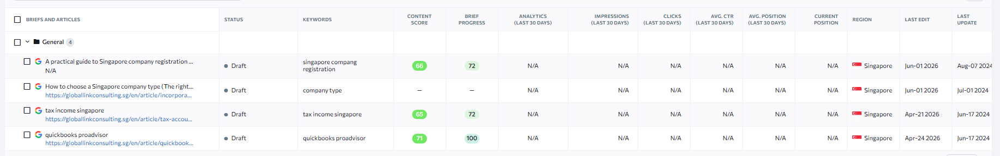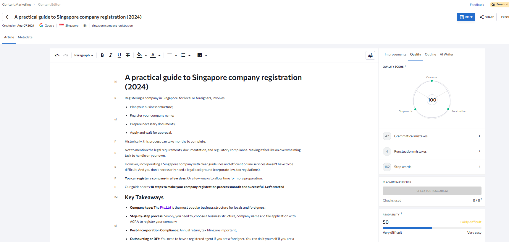 | Cao |
| 2 | Xây dựng nút bấm chuyển trạng thái/chuyển bước dễ dùng hơn. Có thể thêm Step-by-step tooltip để điều hướng user sử dụng | Bình thường |
| 3 | - Bổ sung cải tiến kết nối việc đăng website trên GLAC EN, GLA ExportHelp<br>- Tạo kết nối API để đưa lên website nhanh | Thấp |

---

# VERSION 2: Cung cấp các thông tin (Cập nhật ngày 08.06.2026)

## Bảng tài khoản phần mềm liên quan (Cập nhật ngày 08.06.2026)

|  | **Cung cấp thông tin** | **Chi tiết** | **Ghi chú khác** |
| --- | --- | --- | --- |
| 1 | <mark style="background: #fffae6;">**1. Tài khoản**</mark> | <mark style="background: #fffae6;">**1. Tài khoản**</mark> | <mark style="background: #fffae6;">**1. Tài khoản**</mark> |
| 2 | SE Ranking <br/> Đăng nhập bằng Google “Sign in with Google“ <br/> [ai.marketing@exporthelp.vn](mailto:ai.marketing@exporthelp.vn) <br/> AImarcom!!2026#@!!@ | <https://online.seranking.com/login.html> | MCP Seranking <br/> <https://seranking.com/api/integrations/mcp/> <br/> <https://api.seranking.com/mcp> <br/>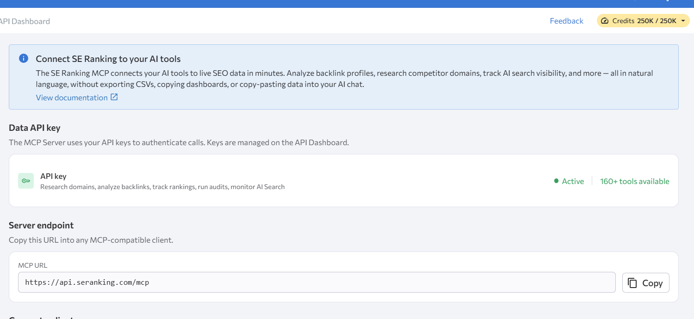 |
| 3 | Screaming Frog <br/> [ai.marketing@exporthelp.vn](mailto:ai.marketing@exporthelp.vn) <br/> @Prteam093853158 <br/> Username: marketingglac2024 <br/> Licence Key: 26417E4A1D-1796342400-8FEC89F254 | Tải về máy cá nhâN <br/> <https://www.screamingfrog.co.uk/seo-spider/> | MCP, lấy trực tiếp trên chính phần mềm <br/>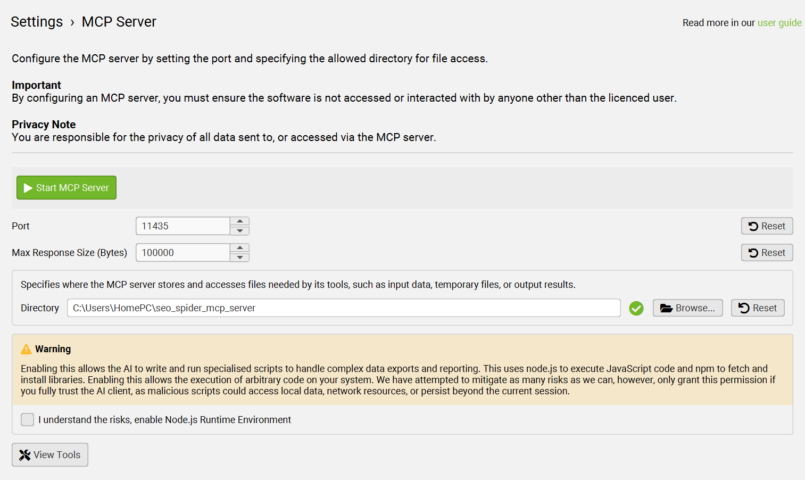 |
| 4 | Tài khoản Reddit <br/> Đăng nhập bằng Google “Sign in with Google“ <br/> [ai.marketing@exporthelp.vn](mailto:ai.marketing@exporthelp.vn) <br/> MK: 12345678@ | <https://www.reddit.com/user/Real-Ordinary1391/> |  |
| 5 | **Canva Pro:** Login với Google <br/> [ai.marketing@exporthelp.vn](mailto:ai.marketing@exporthelp.vn) AImarcom!!2026#@!!@@ | <https://www.canva.com/vi_vn/> | (Cần xác thực 2 lớp, liên hệ Ivy/Daniel)  MCP Agent setup document: <https://www.canva.com/vi_vn/help/mcp-agent-setup/> |
| 6 | **Figma**: Login with Google <br/> [ai.marketing@exporthelp.vn](mailto:ai.marketing@exporthelp.vn) AImarcom!!2026#@!!@@ | <https://www.figma.com/> | Figma MCP Agent: <https://www.figma.com/mcp-catalog/> |
| 7 | **Depositphotos**: Login with email <br/> [admin@exporthelp.vn](mailto:admin@exporthelp.vn) @GLAC588 | <https://depositphotos.com/> | Không có MCP |
| 8 | **Pictory**: Login with email <br/> [admin@exporthelp.vn](mailto:admin@exporthelp.vn) PictoryGLAC2022# | <https://app.pictory.ai/login> | Pictory MCP: <https://pictory.ai/pictory-mcp-server-api?el=425&htrafficsource=pictoryblog> |
| 9 | **Viettel AI TTS**: Login with email <br/> [ai.marketing@exporthelp.vn](mailto:ai.marketing@exporthelp.vn) AITTS@MarComIT@072025 | <https://sso.viettelai.vn/login?client_id=9acff806-d32e-42d1-a938-496bc10380f8&redirect_uri=https://viettelai.vn/auth/viettelai-sso-callback&response_type=code&scope=openid%20email%20profile%20phone&state=svyRD6YflD&code_challenge=axHj9rmR4fEcQF3GV8UgtaI3HrIfQo5zPT0KeyedONc&code_challenge_method=S256> | (Cần xác thực 2 lớp bằng cách cung cấp mã 2FA, liên hệ Ivy) <br/> <font style="color: #ff5630;">Có API để tích hợp, nhưng chưa rõ là có MCP không?</font> |
| 10 | **Google AI Studio (Generate Speech):** sử dụng 1 tài khoản Gmail để đăng ký sử dụng, công ty chưa đăng ký license công cụ này | <https://aistudio.google.com/generate-speech> | Có MCP thông qua API key <br/> <https://github.com/eternnoir/aistudio-mcp-server> |
| 11 | <mark style="background: #fffae6;">**2. Link bài viết (3 bài viết EN, 3 bài viết VI mỗi website)**</mark> | <mark style="background: #fffae6;">**2. Link bài viết (3 bài viết EN, 3 bài viết VI mỗi website)**</mark> | <mark style="background: #fffae6;">**2. Link bài viết (3 bài viết EN, 3 bài viết VI mỗi website)**</mark> |
| 12 | Website GLAC | **Bài viết VI:** <br/> **https://globallinkconsulting.sg/vi/bai-viet/thue-ke-toan-nuoc-ngoai/thue-ke-toan-my/top-5-loai-thue-quan-trong-tai-my** <br/> https://globallinkconsulting.sg/vi/bai-viet/thanh-lap-cong-ty-tai-nuoc-ngoai/thanh-lap-cong-ty-thai-lan/thanh-lap-cong-ty-thuong-mai-tai-thai-lan <br/> https://globallinkconsulting.sg/vi/bai-viet/tai-khoan-ngan-hang-nuoc-ngoai/tai-khoan-ngan-hang-singapore/tai-khoan-ngan-hang-dong-bang <br/> https://globallinkconsulting.sg/vi/bai-viet/thanh-lap-cong-ty-tai-nuoc-ngoai/xay-dung-thuong-hieu-quoc-te <br/> Bài EN: <br/> <https://globallinkconsulting.sg/en/article/tax-accounting/tax-accounting-in-singapore/singapore-tax-relief> <br/> <https://globallinkconsulting.sg/en/article/bank-account-opening/frozen-bank-account> <br/> <https://globallinkconsulting.sg/en/article/bank-account-opening/bank-account-opening-in-singapore/can-a-foreigner-open-a-bank-account-in-singapore> |  |
| 13 | Website GLA (Website GLA chỉ đang triển khai nội dung VI) | <https://globallinks.asia/cam-nang/thue-hang-hoa-va-dich-vu-gst-tai-singapore> <br/> <https://globallinks.asia/cam-nang/visa-lam-viec-singapore> <br/> <https://globallinks.asia/cam-nang/kinh-doanh-coffee-tai-hong-kong> <br/> <https://globallinks.asia/cam-nang/ma-so-ein-cong-ty-my> |  |
| 14 | Website ExportHelp (Website ExportHelp chỉ đang triển khai nội dung VI) | <https://exporthelp.asia/vi/blog/von-dieu-le-cong-ty-trung-quoc> <br/> <https://exporthelp.asia/vi/blog/thanh-lap-cong-ty-wfoe> <br/> <https://exporthelp.asia/vi/blog/loai-hinh-cong-ty-trung-quoc> |  |
| 15 | Reddit | 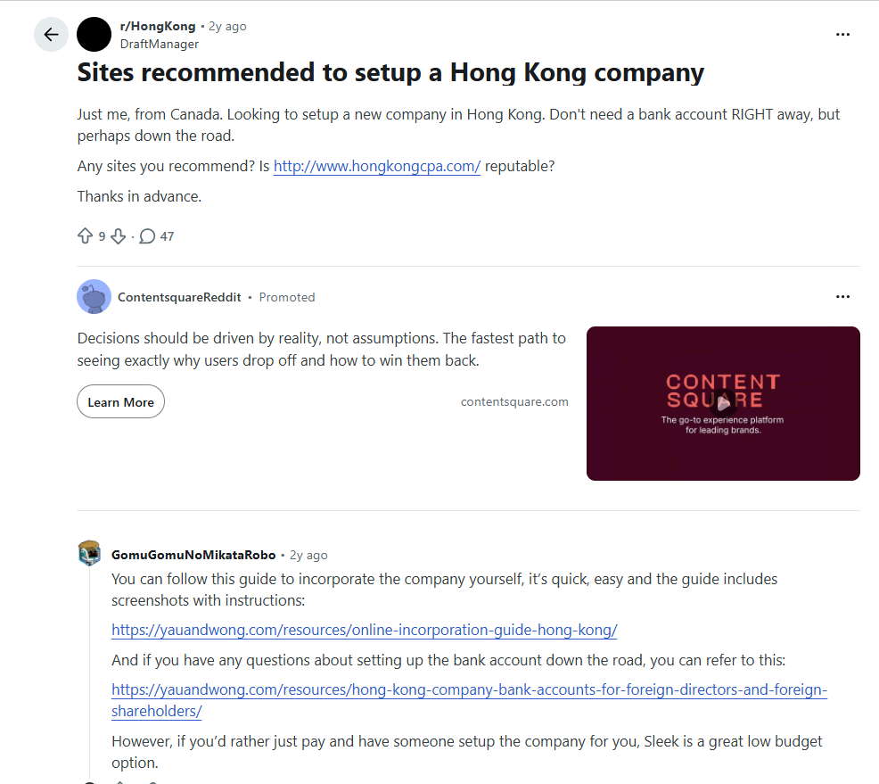 <https://www.reddit.com/r/HongKong/comments/1ep92ky/sites_recommended_to_setup_a_hong_kong_company/> | ❓ Researcher cần kì vọng vào reddit lấy thông tin như thế nào? <br/> Về cơ bản Reddit là group trao đổi trong cộng đồng <br/> Nên kỳ vọng Researcher sẽ ghi nhận các thông tin sau <br/>1. Câu hỏi chính của người đăng bài<br>2. Các câu trả lời cho câu hỏi chính đó (lấy theo lượt thích từ cao xuống thấp) Trình bày dạnh bảng: (thường này ko cố định số lượng, càng nhiều càng tốt ạ, ít nhất 20 <br/> <table class="confluenceTable" data-layout="default" data-local-id="9fe20a6a-dfbf-44c3-9132-14176d949531" data-table-width="760"><tbody><tr data-local-id="ecfa75b842c1"><th class="confluenceTh" data-local-id="372a2849fc64"><p local-id="97402a5bee53"><strong>Vấn đề hỏi</strong></p></th><th class="confluenceTh" data-local-id="921015dea67a"><p local-id="0aa543ef164a"><strong>Câu trả lời </strong></p></th><th class="confluenceTh" data-local-id="a62a7a1fa1a2"><p local-id="bdd96b17aad6"><strong>Đánh giá mức độ đáng tin cậy</strong></p></th></tr><tr data-local-id="a00f126927e7"><td class="confluenceTd" data-local-id="5f45f195bf7c"><p local-id="9191469d5dff">Đề xuất site hỗ trợ mở công ty HK</p></td><td class="confluenceTd" data-local-id="21014485c2bd"><p local-id="eadaee745959">Xem xét 3 bên sau nhé</p><p local-id="28565a978d34">Law</p><p local-id="391eed4bf33d">Sleek</p><p local-id="f5a6995e996d">Ossome</p></td><td class="confluenceTd" data-local-id="3834842c5720"><p local-id="6e14fda613e3">Cao, có thể dùng làm tư liệu tham khảo</p></td></tr></tbody></table> |
| 16 | <mark style="background: #fffae6;">**3. File Exel** <br/> *Gửi lại file excel.. phần research có bổ sung thì thêm màu, cột ntn để đọc vào là hiểu cái yêu cầu này mới thêm vào từ*</mark> | <mark style="background: #fffae6;">**3. File Exel** <br/> *Gửi lại file excel.. phần research có bổ sung thì thêm màu, cột ntn để đọc vào là hiểu cái yêu cầu này mới thêm vào từ*</mark> | <mark style="background: #fffae6;">**3. File Exel** <br/> *Gửi lại file excel.. phần research có bổ sung thì thêm màu, cột ntn để đọc vào là hiểu cái yêu cầu này mới thêm vào từ*</mark> |
| 17 | <https://docs.google.com/spreadsheets/d/1YDUnV-mx1tx995UVfDGKkBT6E7gKnLDtvUa054e9DvQ/edit?gid=1393425868#gid=1393425868> <br/> Sheet 0. Quy trình mô tả <br/>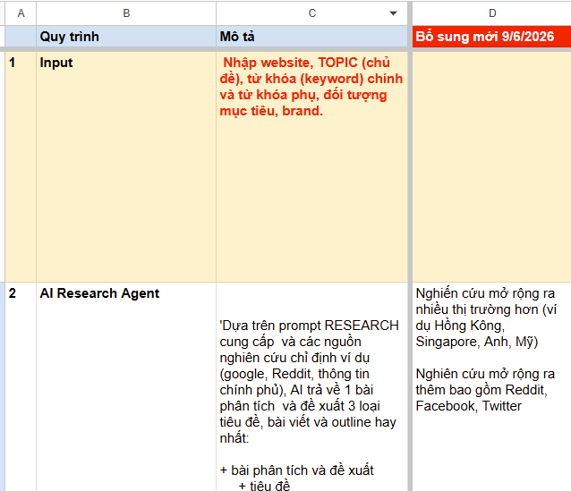 | <https://docs.google.com/spreadsheets/d/1YDUnV-mx1tx995UVfDGKkBT6E7gKnLDtvUa054e9DvQ/edit?gid=1393425868#gid=1393425868> <br/> Sheet 0. Quy trình mô tả <br/> | <https://docs.google.com/spreadsheets/d/1YDUnV-mx1tx995UVfDGKkBT6E7gKnLDtvUa054e9DvQ/edit?gid=1393425868#gid=1393425868> <br/> Sheet 0. Quy trình mô tả <br/> |
| 18 | <mark style="background: #fffae6;">**4. Nhận xét hình**</mark> | <mark style="background: #fffae6;">**4. Nhận xét hình**</mark> | <mark style="background: #fffae6;">**4. Nhận xét hình**</mark> |
| 19 | 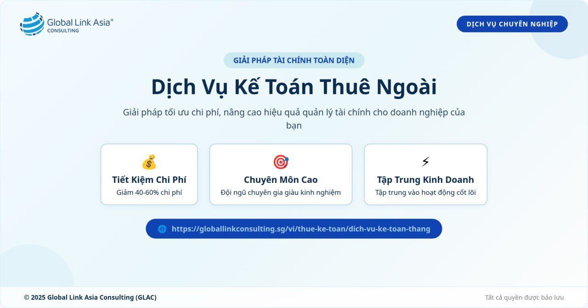 | **I. Về quy tắc màu sắc và typography:** <br/> ```java<br/>=== BACKGROUND ===<br/>Use ONE of the following backgrounds (chosen based on content contrast):<br/>- Solid: #fdfdfd (first choice)<br/>- Linear gradient 90°: #f3fbff → #edf8ff<br/>- Linear gradient 180°: #edf8ff → #f3fbff<br/>- Solid: #eaf7fb<br/><br/>=== COLOR PALETTE ===<br/>1. Core Colors (primary use for charts, icons, key elements):<br/>- Curious Blue: #2298D5 (and tints: #2298D5, #5AA5DA, #84ADDC, #0D86E2, #156CF1, #89CA78, #86D04F, #B6DEF3, #CDE9F7)<br/>- Yale Blue: #0F44B2 (and tints: #0F44B2, #6639B, #2D63B9, #3C75A8, #07B8A4, #778DC5, #9B93D3, #BCCBE2, #D7E4FD)<br/>- Baby Blue: #9DC8EA (and tints: #9DC8EA, #A6DAED, #B8DCEF, #B6CDF1, #C3B9F5, #CCE4F5, #D4EEF7, #E0F2F9, #EAF7F8)<br/><br/>2. Base Colors (backgrounds, text, borders):<br/>- Blue Whale: #0D2D4F (primary text color)<br/>- Tiffany Blue: #95CEE2<br/>- Ice Blue Lily: #CAE9F1<br/>- Granite: #808080<br/>- Milk White: #FDFDFD<br/><br/>3. Accent Colors (CTA Buttons flexibly, highlighting a specific word for emphasis)<br/>- Saffron Mango: #FBBC3F<br/>```  **II. Đối với kích thước hình ảnh được sử dụng lồng ghép vào nội dung bài viết:** <br/>1. File size: Bắt buộc dưới 150 KB, tốt nhất khi dưới 100 KB<br>2. Dimension (width x height): Khung của thiết kế trang bài viết trên website có chiều ngang là 1200px, do đó kích thước chung của ảnh này là **1200 x 630px** |  |
| 20 | <mark style="background: #fffae6;">**5. Token 2 website GLAC, GLA**</mark> | <mark style="background: #fffae6;">**5. Token 2 website GLAC, GLA**</mark> | <mark style="background: #fffae6;">**5. Token 2 website GLAC, GLA**</mark> |
| 21 | Website GLAC | API Token: <br/> c2hhMjU2Ojg5NTo2NmIzY2IxZGUwMTExYjFhNmVhNmE0YTBmYjdlODBkMjNmMzI5ZDY3NjE2YWIwNzg2NTlkY2Q1ZTNhMjliNzYx <br/> ID Category: 575 | ID Category: 575 (Category : Thành lập công ty tại SIngapore) <br/> GLAC có nhiều Category, vì vậy, khi tạo bài viết, cần chọn Category phù hợp. |
| 22 | Website GLA | API Token <br/> c2hhMjU2OjYyOmMwYTFkMDIyZDVmNWU5MGE0NzE5YjJkMDIzM2U2OTE1MWFiMTRkNzE5MTYxN2I5NmQ5MjUzZjBkODAyMjVjMWU= <br/> ID Category: 253 | GLA chỉ có 1 Category đăng bài. |
| 23 | <mark style="background: #fffae6;">**6. Model AI nào viết bài tốt hơn** <br/> *Cùng 1 bài này Ivy Daniel cho nhận xét là model.. viết bài hiện tại (model Qwen Quý đang dùng) thì viết tốt hơn.. ý là văn phong tiếng Việt.v.v.? hay model mới này tốt hơn? về tính tuân thủ.v.v.*</mark> | <mark style="background: #fffae6;">**6. Model AI nào viết bài tốt hơn** <br/> *Cùng 1 bài này Ivy Daniel cho nhận xét là model.. viết bài hiện tại (model Qwen Quý đang dùng) thì viết tốt hơn.. ý là văn phong tiếng Việt.v.v.? hay model mới này tốt hơn? về tính tuân thủ.v.v.*</mark> | <mark style="background: #fffae6;">**6. Model AI nào viết bài tốt hơn** <br/> *Cùng 1 bài này Ivy Daniel cho nhận xét là model.. viết bài hiện tại (model Qwen Quý đang dùng) thì viết tốt hơn.. ý là văn phong tiếng Việt.v.v.? hay model mới này tốt hơn? về tính tuân thủ.v.v.*</mark> |
| 24 | Daniel đánh giá Model AI nào viết bài tốt hơn |  | Em thường dùng để viết tiếng Anh thì em thấy <br/> Model SG Slang 4.7 Flash em thường dùng viết ổn định hơn ạ <br/> Model SG Slang 3.7 Flash mới có thì em thấy viết tốt hơn ạ <br/> Về tiếng anh thì các Model này đều viết ổn ạ, do mình có thể lệnh cho các model viết theo văn phong mình muốn <br/> Mode Qwen thì em thấy cũng ổn ạ, do bản chât mình vẫn có thể kêu ai chatbot viết lại theo văn phong yêu cầu ạ.  Còn model mới đang cài đặt trên tool viết bài do đã cài đặt cứng trên hệ thống theo tài liệu được học thì output của tool em thấy chưa tuân thủ đúng yêu cầu tài liệu ạ |
