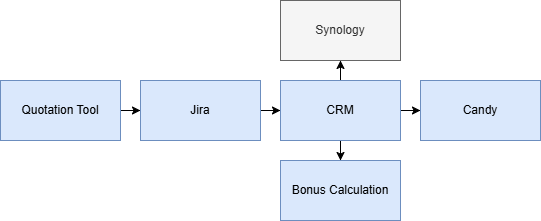
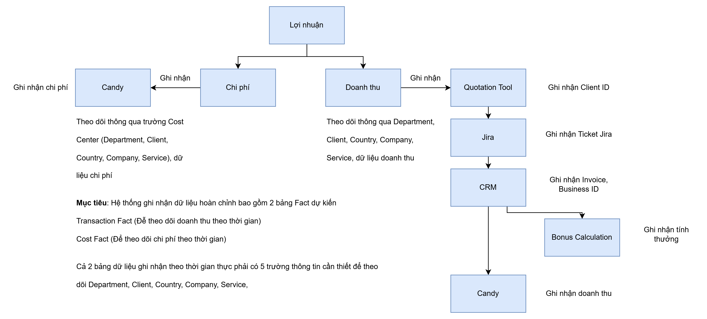
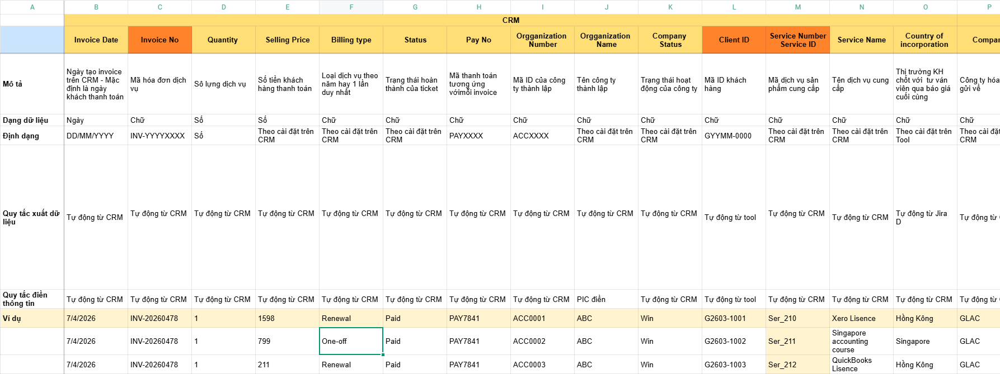

Marcoms MSD 2026 > Dự án Đồng bộ hệ thống_Data Sync - 05.2026

# Project Overview\_Data Sync\_20/5/2026

# Tổng qua hành trình quản trị KH và nội bộ qua công cụ

# Tổng quan logic quản trị dữ liệu tài chính từ KH và nội bộ (dự kiến)

> [!IMPORTANT]
> 2 bảng quan trọng nhất cần theo dõi xuyên suốt dữ liệu tài chính là Transaction Fact và Cost Fact → kết nối thông qua **Servive ID**
>
> Tận dụng CRM xuất dữ liệu để có cơ chế ghi nhận này + kết nối bảng dữ liệu với Jira và Quote, để có thông số đầy đủ nhất

# Các công việc đã triển khai để ghi nhận, sử dụng dữ liệu cho bảng Transaction Fact

| **Công việc** | **Đã đồng bộ dữ liệu giữa các hệ thống?** | **Ghi nhận dữ liệu gì?** |
| --- | --- | --- |
| Triển khai Quotation Tool | Đã đồng bộ Quotation - Jira - CRM về Client ID | Theo dõi được Client ID xuyên suốt |
| Sử dụng Jira | Đồng bộ giữa Jira - Bonus Calculation | Theo dõi được Department - PIC hỗ trợ |
| Triển khai Bonus Calculation | Đồng bộ giữa Jira - Bonus Calculation | Theo dõi được hoạt động ghi nhận Bonus   nh thưởng các PIC dịch vụ tương ứng dựa vào 4 yếu tố sau  - Ticket Jira  - Invoice - PO (Đã Paid)  - Service ID  - Business Unit (Department) - PIC |
| Sử dụng CRM |  | Theo dõi   Country   Company (Org ID)   Service   Invoice ID   Pay ID (nếu đã thanh toánh)   Revenue ước tính   Revenue thực tế   Service ID |

> [!IMPORTANT]
> Cột quan trọng nhất để theo dõi Transaction Fact hiệu quả sẽ là **cột Invoice ID và Service ID** đó kết nối dữ liệu tương ứng để phân tích đầy đủ dữ liệu doanh thu theo dõi đa chiều

Mẫu dữ liệu Transaction Fact dự kiến để sử dụng

<https://drive.globallinkconsulting.sg/oo/r/18JZ4HjC1mPnKBifjq3VPqmDzkqMBLqR#tid=5>

# Các công việc đã triển khai để ghi nhận, sử dụng dữ liệu cho bảng Cost Fact

| **Công việc**             | **Ghi nhận dữ liệu gì?**                                               |
|:--------------------------|:-----------------------------------------------------------------------|
| Triển khai ứng dụng Candy | Theo dõi được dữ liệu quan trọng liên quan tới chi phí đối ứng dịch vụ |

# Kế hoạch triển khai dự kiến

| **Task** | **PIC** | **DueDate** | **Link** |
| --- | --- | --- | --- |
| Tạo Project Overview để nắm triển khai | Daniel | 20/5 | <https://globallinkasiaconsulting.atlassian.net/wiki/spaces/MSD/pages/edit-v2/5438046279?draftShareId=f88a95fc-fa4c-43cc-9ffe-b1ee8aacbc2e> |
| Báo cáo đề xuất Service ID chuẩn để áp dụng triển khai | Daniel | 20/5 |  |
| Tạo bảng mẫu cột dữ liệu dự kiến cho Transaction Fact | Daniel | 20/5 |  |
| Tạo bảng Service ID chuẩn để áp dụng | Daniel | 26/5 |  |
| Tạo Project plan dự kiến để ghi nhận task cần làm | Daniel | 27/5 |  |
| Nghiên cứu, triển khai ghi nhận theo dõi trên Candy | Crystal, Ann, Helen |  |  |
