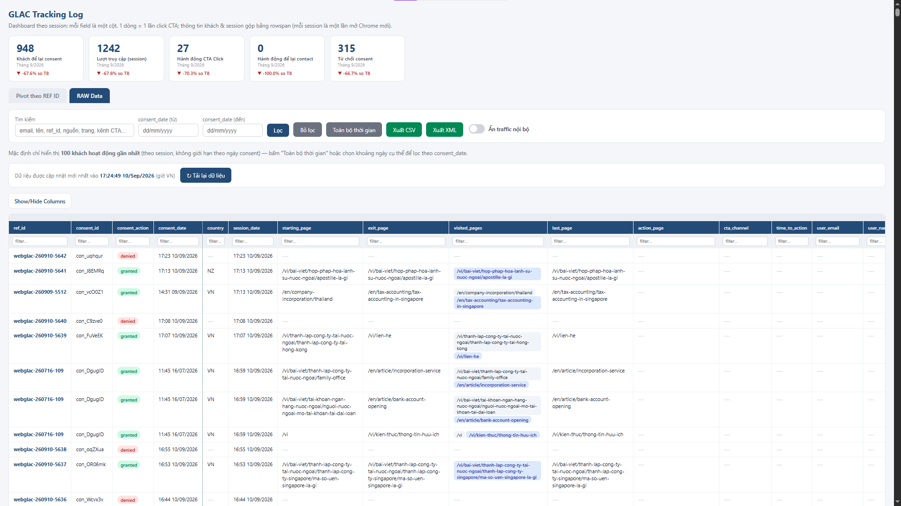
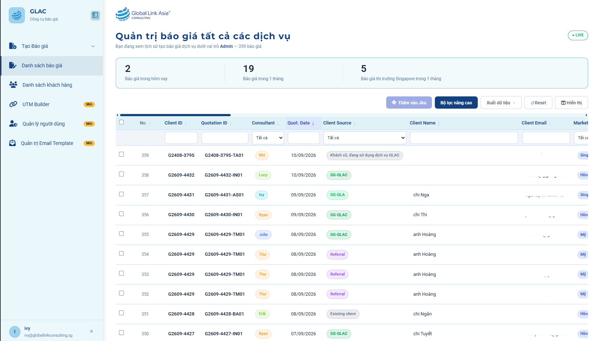
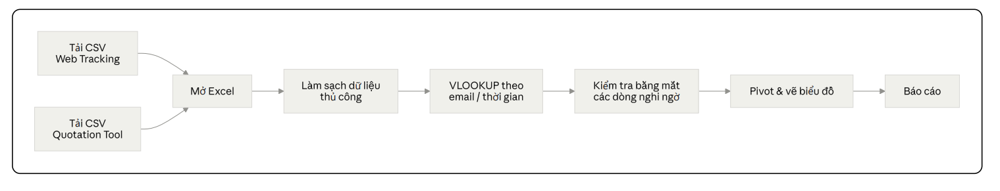
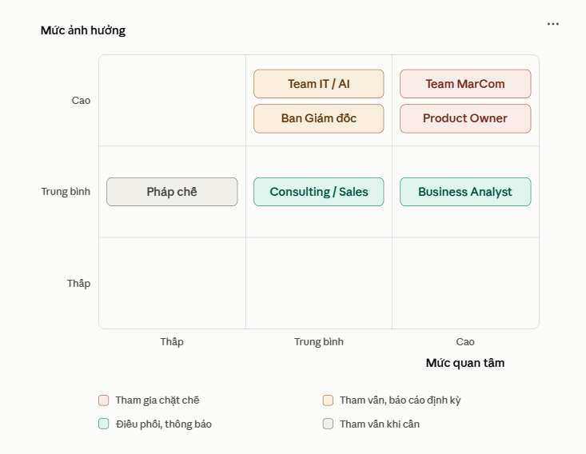
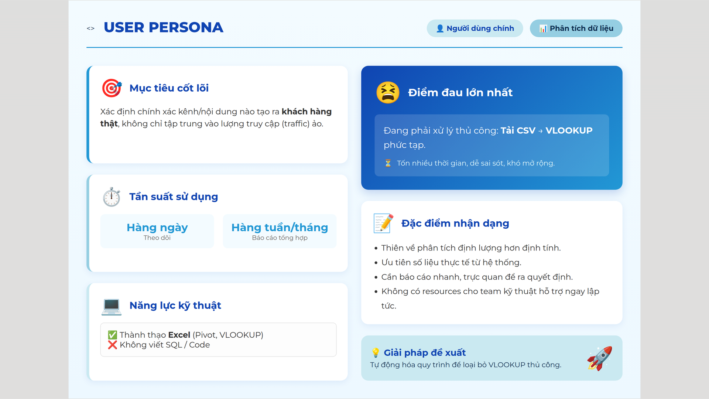
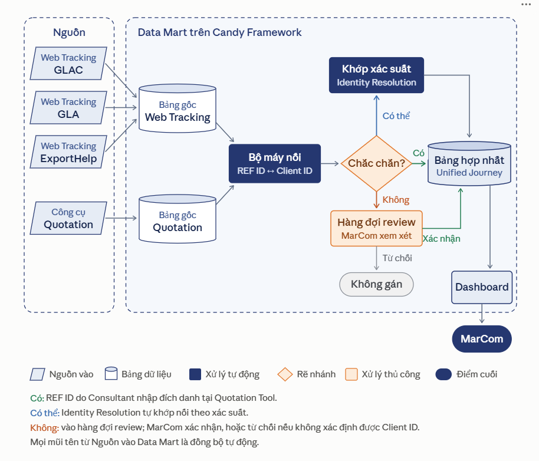
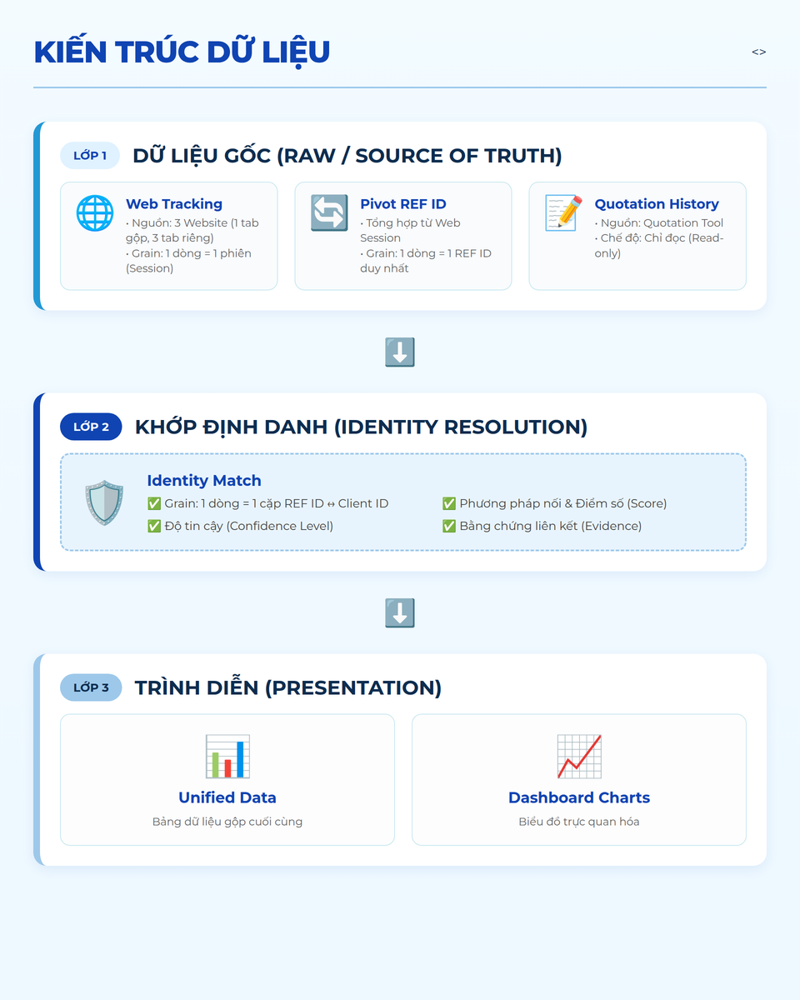
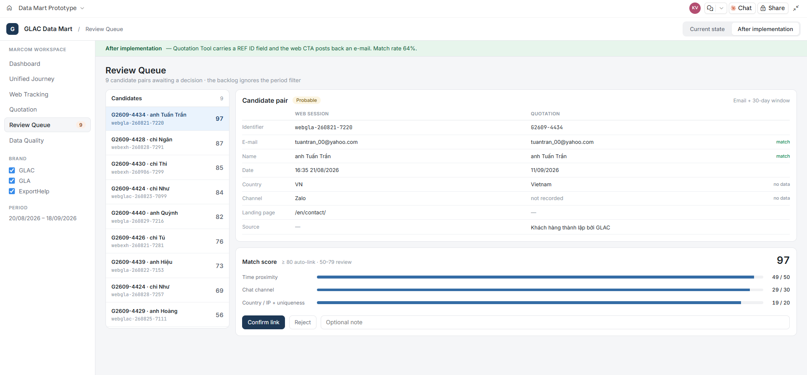
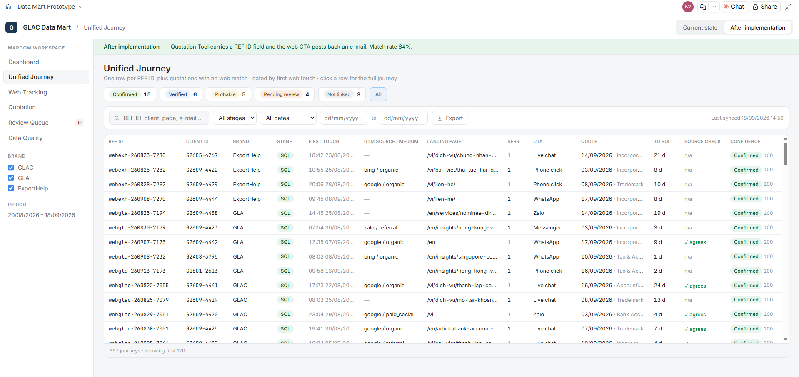

Marcoms MSD 2026 > Dự án Đồng bộ hệ thống_Data Sync - 05.2026 > [Data mart Quotation-Jira-CRM_Data Sync_17/6/2026](Data%20mart%20Quotation-Jira-CRM_Data%20Sync_17_6_2026.md)

# \[BRD\] Web Tracking Tool & Quotation History - Marketing Module trên Candy - 23.09.2026

|          |                                                  |
|:---------|:-------------------------------------------------|
| Preparer | Ivy Nguyen                                       |
| Reporter | Chị Hong Anh, anh Steven Nguyen (cc: chị Winnie) |
| Date     | 2026-09-23                                       |

> [!NOTE]
> Chú thích: Business Require Document (BRD): là tài liệu mô tả chi tiết các yêu cầu kinh doanh về dự án, chương trình, phần mềm. Một tài liệu BRD bao gồm hệ thống thông tin tổng quan từ tiềm lực công ty, sản phẩm dịch vụ, chiến lược, định hướng phát triển sản phẩm cụ thể, ngân sách, rủi ro,v.v. Tài liệu này còn ghi nhận những ý kiến của các bên liên quan đối với sản phẩm dịch vụ, mục tiêu tạo sự gắn kết, đưa ra các giải pháp để triển khai dự án thành công.

- [Bối cảnh dự án:](#id-brdwebtrackingtoolquotationhistory-marketingmoduletrêncandy-23092026-bốicảnhdựán)
- [0. Tài nguyên dữ liệu hiện có](#id-brdwebtrackingtoolquotationhistory-marketingmoduletrêncandy-23092026-0tàinguyêndữliệuhiệncó)
  - [0.1. GLAC Web Tracking](#id-brdwebtrackingtoolquotationhistory-marketingmoduletrêncandy-23092026-01glacwebtracking)
  - [0.2. CRM Marketing (thu Form)](#id-brdwebtrackingtoolquotationhistory-marketingmoduletrêncandy-23092026-02crmmarketingthuform)
  - [0.3. Quotation Tool](#id-brdwebtrackingtoolquotationhistory-marketingmoduletrêncandy-23092026-03quotationtool)
- [1. Vấn đề](#id-brdwebtrackingtoolquotationhistory-marketingmoduletrêncandy-23092026-1vấnđề)
  - [Bảng tóm tắt vấn đề](#id-brdwebtrackingtoolquotationhistory-marketingmoduletrêncandy-23092026-bảngtómtắtvấnđề)
- [2. Mục tiêu dự án](#id-brdwebtrackingtoolquotationhistory-marketingmoduletrêncandy-23092026-2mụctiêudựán)
- [3. Phạm vi công việc](#id-brdwebtrackingtoolquotationhistory-marketingmoduletrêncandy-23092026-3phạmvicôngviệc)
  - [3.1. Phạm vi team MarCom](#id-brdwebtrackingtoolquotationhistory-marketingmoduletrêncandy-23092026-31phạmviteammarcom)
  - [3.2. Phạm vi team IT, AI](#id-brdwebtrackingtoolquotationhistory-marketingmoduletrêncandy-23092026-32phạmviteamitai)
  - [3.3. Mức độ ảnh hưởng của các bên đối với dự án](#id-brdwebtrackingtoolquotationhistory-marketingmoduletrêncandy-23092026-33mứcđộảnhhưởngcủacácbênđốivớidựán)
- [4. Chân dung người dùng và câu chuyện người dùng module](#id-brdwebtrackingtoolquotationhistory-marketingmoduletrêncandy-23092026-4chândungngườidùngvàcâuchuyệnngườidùngmodule)
  - [4.1. User Persona chính: Thành viên team MarCom](#id-brdwebtrackingtoolquotationhistory-marketingmoduletrêncandy-23092026-41userpersonachínhthànhviênteammarcom)
  - [4.2. User Stories](#id-brdwebtrackingtoolquotationhistory-marketingmoduletrêncandy-23092026-42userstories)
- [5. Kiến trúc dữ liệu](#id-brdwebtrackingtoolquotationhistory-marketingmoduletrêncandy-23092026-5kiếntrúcdữliệu)
- [6. Danh sách các trường của các bảng dữ liệu](#id-brdwebtrackingtoolquotationhistory-marketingmoduletrêncandy-23092026-6danhsáchcáctrườngcủacácbảngdữliệu)
  - [6.1. Định nghĩa các giai đoạn cảu phễu Traffic → MQL → SQL](#id-brdwebtrackingtoolquotationhistory-marketingmoduletrêncandy-23092026-61địnhnghĩacácgiaiđoạncảuphễutrafficmqlsql)
  - [6.1. Web Tracking (Lớp 1)](#id-brdwebtrackingtoolquotationhistory-marketingmoduletrêncandy-23092026-61webtrackinglớp1)
  - [6.2. Quotation History (Lớp 1)](#id-brdwebtrackingtoolquotationhistory-marketingmoduletrêncandy-23092026-62quotationhistorylớp1)
  - [6.3. Identity Match (Lớp 2)](#id-brdwebtrackingtoolquotationhistory-marketingmoduletrêncandy-23092026-63identitymatchlớp2)
  - [6.4. Unified Data (Lớp 3)](#id-brdwebtrackingtoolquotationhistory-marketingmoduletrêncandy-23092026-64unifieddatalớp3)
- [7. Mô tả chức năng](#id-brdwebtrackingtoolquotationhistory-marketingmoduletrêncandy-23092026-7môtảchứcnăng)
  - [7.1. Chức năng Review Queue của Identity Match](#id-brdwebtrackingtoolquotationhistory-marketingmoduletrêncandy-23092026-71chứcnăngreviewqueuecủaidentitymatch)
- [8. Yêu cầu phi chức năng](#id-brdwebtrackingtoolquotationhistory-marketingmoduletrêncandy-23092026-8yêucầuphichứcnăng)
  - [8.1. Hiệu năng và mức độ real-time của dữ liệu](#id-brdwebtrackingtoolquotationhistory-marketingmoduletrêncandy-23092026-81hiệunăngvàmứcđộreal-timecủadữliệu)
  - [8.2. Phân quyền](#id-brdwebtrackingtoolquotationhistory-marketingmoduletrêncandy-23092026-82phânquyền)
- [Prototype thực tế của dự án:](#id-brdwebtrackingtoolquotationhistory-marketingmoduletrêncandy-23092026-prototypethựctếcủadựán)
- [Action Plan:](#id-brdwebtrackingtoolquotationhistory-marketingmoduletrêncandy-23092026-actionplan)

> [!NOTE]
> ## Bối cảnh dự án:
>
> **Vấn đề:**
>
> - GLAC đang vận hành 2 công cụ dữ liệu độc lập là **Web Tracking Log** (hành vi người dùng trên website) và **Quotation Tool** (báo giá). Hai nguồn không được nối với nhau. Mỗi lần cần báo cáo hành trình khách hàng, MarCom phải tải CSV từ từng công cụ và đối chiếu thủ công bằng VLOOKUP.
> - Hệ quả là GLAC chỉ đo được đến bước “có traffic”, không biết kênh hay nội dung nào thực sự tạo ra cơ hội sales thành công.
> - Web Tracking Log sắp mở rộng từ 1 lên 3 website (GLAC, GLA, ExportHelp), khiến khối lượng đối chiếu thủ công tăng gấp 3.
>
> **Giải pháp:**
>
> Xây dựng một module Data Mart trên Candy Framework để:
>
> 1. Lưu trữ trung thực dữ liệu gốc của cả hai công cụ;
> 2. Tự động nối **REF ID** (định danh người dùng web) với **Client ID** (định danh trong Quotation Tool và đi theo khách hàng đến suốt hành trình) theo bộ quy tắc có mức tin cậy;
> 3. Trình diễn toàn bộ hành trình **Traffic → MQL → SQL** trên một giao diện duy nhất, có biểu đồ, bộ lọc và export.
>
> **Lợi ích chính:**
>
> - Thời gian lập báo cáo hành trình hàng tháng giảm từ nhiều giờ xuống **dưới 15 phút**
> - **≥ 60%** báo giá được tự động nối với nguồn web
> - MarCom có căn cứ định lượng để phân bổ nguồn lực các kênh và nội dung giữa 3 thương hiệu
>
> **Phạm vi giai đoạn 1:**
>
> - Chỉ phục vụ team MarCom, dừng ở phễu SQL. Phễu Client, tích hợp CRM/Jira/kế toán và marketing automation thuộc giai đoạn sau.

## 0. Tài nguyên dữ liệu hiện có

Team MarCom đang vận hành hai công cụ tự xây, hoạt động độc lập với nhau và chưa có cơ chế kết nối dữ liệu.

### 0.1. GLAC Web Tracking

**Web Tracking Log**: ghi nhận phiên truy cập, nguồn truy cập, trang xem, hành động chuyển đổi của người dùng web. Mỗi người dùng được gắn một REF ID.

🔗 <https://globallinkconsulting.sg/index.php?glactrack=view&key=a3f8c2d1e4b7901f6a2c5d8e3f1b4c9d>

|  | **Hạng mục** | **Hiện trạng** |
| --- | --- | --- |
| 1 | Đơn vị dữ liệu | Một dòng tương ứng một phiên truy cập; bảng đang được pivot theo REF ID nên các phiên của cùng một người hiển thị thành một khối |
| 2 | Key định danh | **REF ID**: mỗi người dùng độc lập được cấp một mã, giữ nguyên qua nhiều phiên truy cập. Quy ước đặt mã có tiền tố thương hiệu: webglac-yymmdd |
| 3 | Số trường dữ liệu | 22 trường, gồm nhóm nhận diện (REF ID, session), nhóm nguồn (kênh truy cập, UTM, referrer), nhóm hành vi (trang đích, số trang xem, thời lượng), nhóm bối cảnh (quốc gia, thiết bị, trình duyệt) và nhóm tương tác (kênh chat, thông tin liên hệ nếu người dùng để lại) |
| 4 | Số lượng phiên | Dưới 1.000 phiên/ngày tính trên toàn bộ hệ thống |
| 5 | Tính chất | Cập nhật real-time |
| 6 | Cách truy cập hiện tại | Xem trực tiếp trên giao diện công cụ hoặc tải file CSV |
| 7 | Kế hoạch mở rộng | Sẽ áp dụng thêm cho hai website còn lại của công ty — GLA và ExportHelp — cùng nhóm dịch vụ, khác thương hiệu và nhận diện. REF ID của hai site này dùng tiền tố `webgla-…` và `webexh-…` |

### 0.2. CRM Marketing (thu Form)

*Đang cải tiến và tối ưu việc thu Form Submission trên các website*

### 0.3. Quotation Tool

**Quotation Tool**: công cụ nội bộ tạo báo giá cho hầu hết dịch vụ tại GLAC. Mỗi khách hàng được báo giá có **Client ID** định dạng `GYYMM-0000`.

> **Lưu ý thuật ngữ:** “Client ID” là mã định danh khách hàng trong Quotation Tool, được cấp **từ lúc tạo báo giá**. Có Client ID **không đồng nghĩa** khách hàng đã ở giai đoạn Client (đã ký hợp đồng). Xem định nghĩa tại Mục 6.2.

|  | **Hạng mục** | **Hiện trạng** |
| --- | --- | --- |
| 1 | Đơn vị dữ liệu | Một dòng tương ứng một báo giá |
| 2 | Key định danh | **Client ID**: mỗi khách hàng tiềm năng độc lập được cấp một mã, định dạng `GYYMM-0000` |
| 3 | Trường dữ liệu chính | Thông tin khách hàng, dịch vụ được báo giá, nguồn khách hàng do người tạo khai nhận, thời điểm tạo, `[cần điền: giá trị báo giá, trạng thái theo dõi]` |
| 4 | Khối lượng | ~40 - 60 báo giá/tháng |
| 5 | Tính chất | Cập nhật khi có báo giá mới   Cập nhật khi báo giá được chuyển lên Jira |
| 6 | Cách truy cập hiện tại | Xem trực tiếp trên giao diện công cụ hoặc tải file CSV |

## 1. Vấn đề

Chi tiết đã đề cập tại [\[Propose\] Phát triển GLAC Data IQ - Data Mart - 19.08.2026](_Propose_%20Phát%20triển%20GLAC%20Data%20IQ%20-%20Data%20Mart%20-%2019.08.2026.md)

### Bảng tóm tắt vấn đề

|  | **Vấn đề** | **Hệ quả** |
| --- | --- | --- |
| 1 | Hai công cụ nằm ở hai nơi, không có cơ chế nối dữ liệu | Mỗi lần cần nhìn bức tranh tổng, MarCom phải tải CSV từng tool, chạy công thức Excel thủ công |
| 2 | Chưa định danh được web user nào gắn với Client nào bằng hệ thống | Không đo được kênh/nội dung nào thực sự tạo ra khách hàng, chỉ đo được tới bước "có traffic" |
| 3 | Thao tác thủ công lặp lại | Tốn thời gian, sai số cao, không tái lập được kết quả giữa các lần báo cáo |
| 4 | Sắp có 3 website cùng chạy Tracking | Khối lượng đối chiếu thủ công sẽ nhân lên gấp 3 nếu không giải quyết P1 ngay |

## 2. Mục tiêu dự án

**Mục tiêu chính:** Đưa dữ liệu của hai công cụ lên một module thống nhất trên Candy Framework, tự động hoá việc nối dữ liệu và trình diễn toàn bộ hành trình **Traffic → MQL → SQL** trên một giao diện duy nhất.(Phễu Client chưa thuộc phạm vi dự án này.)

|  | **Mục tiêu cụ thể** | **Đo lường thành công** |
| --- | --- | --- |
| 1 | Trình diễn trung thực bảng dữ liệu gốc của từng công cụ | Số bản ghi và giá trị từng trường trên module khớp 100% với nguồn |
| 2 | Hợp nhất thành một bảng dữ liệu chung | Không có bản ghi bị mất, bị nhân đôi, hay bị gộp nhầm mà không có nhãn cảnh báo |
| 3 | Tự động nối REF ID ↔ Client ID | ≥ 60% Client được nối tự động với REF ID trong 3 tháng đầu (baseline hiện tại: 0%) |
| 4 | Trình diễn dữ liệu bằng biểu đồ để người xem đưa ra phán đoán, nhận định | MarCom trả lời được 7 câu hỏi nghiệp vụ ở Mục 8 mà không cần mở file .csv, hay bảng dữ liệu raw |
| 5 | Loại bỏ thao tác đối chiếu thủ công | Thời gian tạo báo cáo hành trình hàng tháng giảm từ nhiều giờ xuống dưới 15 phút   Có thể xem báo cáo mỗi ngày, tuần |

> [!NOTE]
> Nguyên tắc thiết kế thông tin xuyên suốt: **Trung thực trước, tiện lợi sau**
>
> Vì việc nối REF ID với Client ID về bản chất là một **phép suy đoán có xác suất**, không phải một sự thật tuyệt đối, trong đó:
>
> - Người dùng phải phân biệt được ngay trên giao diện: đâu là **dữ liệu gốc**, đâu là **dữ liệu suy luận**.
> - Mọi biểu đồ phải ghi rõ tỷ lệ dữ liệu đã nối làm cơ sở, tránh việc người xem hiểu nhầm một biểu đồ dựa trên 40% dữ liệu là bức tranh toàn bộ.

## 3. Phạm vi công việc

### 3.1. Phạm vi team MarCom

1. Kiểm tra tính đồng bộ và lưu trữ dữ liệu Tracking Web của cả 3 website vào module
2. Kiểm tả tính đồng bộ và lưu trữ dữ liệu Quotation Tool vào module
3. Cơ chế định danh tự động REF ID ↔ Client ID (identity resolution, matching rules)
4. Hàng đợi review thủ công cho các trường hợp nối không chắc chắn
5. 3 màn hình bảng dữ liệu của Web Tracking, Quotation, Unified Data
6. 01 màn hình Dashboard biểu đồ
7. Bộ lọc, tìm kiếm, export CSV/Excel trên mọi bảng
8. Phân quyền theo vai trò MarCom (ưu tiên team MarCom sử dụng trước)

> Ghi chú phân quyền: Ở giai đoạn 1, module chỉ phục vụ MarCom. Tuy nhiên schema cần thiết kế sẵn trường `role_visibility` hoặc tương đương để mở rộng cho C-Level/Consulting ở giai đoạn sau.

### 3.2. Phạm vi team IT, AI

1. Lựa chọn app/module cụ thể trên Candy Framework
2. Kiến trúc hạ tầng, hosting, CI/CD, backup
3. Tích hợp CRM, Jira, hệ thống kế toán (có thể là giai đoạn 2)
4. Thay đổi logic tính giá bên trong Quotation Tool
5. Việc gắn tracking script lên website (đã có sẵn, chỉ mở rộng thêm 2 site)
6. Marketing automation, gửi email tự động

### 3.3. Mức độ ảnh hưởng của các bên đối với dự án

## 4. Chân dung người dùng và câu chuyện người dùng module

### 4.1. User Persona chính: Thành viên team MarCom

### 4.2. User Stories

**<mark style="background: #c6edfb;">“Tôi là MarCom, tôi muốn …, để …”</mark>**

|  | **Tôi muốn…** | **để…** |
| --- | --- | --- |
| 1 | xem bảng Tracking Web đầy đủ, lọc theo brand/thời gian/nguồn | kiểm tra hành vi user mà không cần vào tool riêng. |
| 2 | xem bảng Quotation đầy đủ, lọc theo dịch vụ/nguồn/trạng thái | theo dõi tình hình báo giá. |
| 3 | xem một bảng hợp nhất mỗi dòng là một hành trình của một REF ID | hiểu user đã làm gì trước khi trở thành client. |
| 4 | biết dòng nào là dữ liệu chắc chắn, dòng nào là suy đoán | không kết luận sai từ dữ liệu chưa chắc chắn. |
| 5 | xác nhận hoặc từ chối các đề xuất nối của hệ thống | dữ liệu ngày càng chính xác hơn theo thời gian. |
| 6 | xem biểu đồ phễu và biểu đồ nguồn | biết nên tăng ngân sách vào kênh nào. |
| 7 | export bất kỳ bảng nào ra CSV | làm báo cáo riêng khi cần. |
| 8 | so sánh hiệu quả giữa 3 thương hiệu website | phân bổ nguồn lực nội dung hợp lý. |

## 5. Kiến trúc dữ liệu

## 6. Danh sách các trường của các bảng dữ liệu

### 6.1. Định nghĩa các giai đoạn cảu phễu Traffic → MQL → SQL

| **Giai đoạn** | **Định nghĩa** | **Sự kiện ghi nhận** | **Nguồn** | **Khoá định danh** |
| --- | --- | --- | --- | --- |
| **Traffic**      ↓ | Một người dùng (REF ID) có ít nhất một phiên truy cập hợp lệ trên một trong 3 website | Page view / session đầu tiên trong kỳ | Web Tracking | REF ID |
| **MQL**  (Marketing Qualified Lead)    ↓ | Người dùng web thực hiện một hành động liên hệ chủ động: gửi form, bắt đầu chat, bấm liên hệ qua kênh nhắn tin | Sự kiện chuyển đổi đầu tiên trong kỳ | Web Tracking   CRM Marketing *(Winnie)* | REF ID (+ email nếu có) |
| **SQL**  (Sales Qualified Lead)  ↓ | Khách hàng được đội ngũ tư vấn tạo ít nhất một báo giá | Ngày tạo báo giá đầu tiên | Quotation Tool | Client ID |
| *Client* | *Khách hàng đã ký hợp đồng / thanh toán* | *Ngoài phạm vi giai đoạn 1* | *CRM / Kế toán* | *Client ID* |

### 6.1. Web Tracking (Lớp 1)

- Giống toàn bộ các trường hiện có trên tab “Raw data” GLAC Web Tracking Log, dành cho 3 website GLAC, GLA và ExportHelp;
- Giống toàn bộ cách bố cụ dữ liệu trên tab “Pivot REF ID” GLAC Web Tracking Log, dành cho 3 website GLAC, GLA và ExportHelp.

### 6.2. Quotation History (Lớp 1)

- Giống bảng Danh sách báo giá trong Quotation Tool nhưng chỉ hiển thị một số thông tin cần thiết phục vụ mục đích team MarCom

### 6.3. Identity Match (Lớp 2)

Một giao diện để MarCom user Xác nhận nối / từ chối REF ID và Client ID

### 6.4. Unified Data (Lớp 3)

Một giao diện bảng tổng hợp và chỉ chọn các dữ liệu thiết yếu từ Traffic (Web Tracking) → MQL (Quotation Tool)

| **#** | **Cột** | **Nguồn** | **Cách tính** |
| --- | --- | --- | --- |
| 1 | REF ID | Web Tracking | Nguyên gốc; trống nếu báo giá chưa nối |
| 2 | Client ID | Quotation | Nguyên gốc; trống nếu hành trình chưa tới SQL |
| 3 | Brand | Dẫn xuất | Suy từ tiền tố REF ID |
| 4 | Stage reached | Dẫn xuất | Traffic / MQL / SQL — giai đoạn cao nhất đạt được   Traffic nếu chỉ có REF ID |
| 5 | First touch | Web Tracking | `session_date` nhỏ nhất của REF ID (thường là phiên session #1) |
| 6 | UTM source/medium | Web Tracking | `utm_source` + `utm_medium` của phiên first touch (session #1) |
| 7 | Starting page | Web Tracking | `starting_page` của phiên first touch |
| 8 | Session | Web Tracking | Đếm số phiên của REF ID |
| 9 | CTA Channel | Web Tracking | Các `cta_channel` của phiên chuyển đổi đầu tiên |
| 10 | Quote Date | Quotation Tool | `Quot. Date` + dịch vụ suy từ hậu tố Quotation ID |
| 11 | Time to SQL | Dẫn xuất | Số ngày từ First touch đến ngày báo giá đầu tiên |
| 12 | Client Source check | Dẫn xuất | Đối chiếu Brand (hoặc UTM source/medium) của Tracking Log với `Client Source` của Quotation Tool |
| 13 | <mark style="background: #c6edfb;">Confidence</mark> | Match engine | Nhãn + điểm khớp |

## 7. Mô tả chức năng

### 7.1. Chức năng Review Queue của Identity Match

> [!IMPORTANT]
> Chức năng Review Queue xảy ra điểm indentity match từ 80 điểm trở lên, theo 1 trong 3 điều kiện bên dưới:

|  | **Điều kiện** | **Điểm** | **Nhãn kết quả tại bảng dữ liệu** |
| --- | --- | --- | --- |
| 1 | **Điều kiện 1:** Có REF ID tại Quotation Tool, đúng định dạng và tồn tại trong Web Tracking | **100**   *Không cần xuất hiện tại Review Queue* | 100 điểm tương đương nhãn *Confirmed* |
| 2 | **Điều kiện 2:** Không có REF ID, nhưng có các thông tin sau được cung cấp bởi Consuntant trong Tạo báo giá:  - Thời điểm liên hệ: thời gian nhận thông tin khách; và  - Kênh liên hệ: là kênh nhận thông tin từ khách (Telegram/WhatsApp/Hotline/Email/…) | **0 – 80 điểm** theo tiêu chí bên dưới | 80 điểm tương đương nhãn *Auto Confirmed*   Dưới 80 điểm:  - Probable  - Pending  - Not linked |
| 3 | **Điều kiện 3:** Chỉ có ngày báo giá và Client source | **0 – 40 điểm** theo tiêu chí bên dưới | - Pending  - Not linked |

#### **7.1.1. Bảng quy tắc tính điểm của Review Card tại <mark style="background: #d3f1a7;">Điều kiện 2</mark>**

✍️ <mark style="background: #f8e6a0;">80 điểm = 50 điểm tiêu chí 1 + 30 điểm tiêu chí 2</mark>

|  | **Tiêu chí** | **Nguồn dữ liệu** | **Cách tính** | **Điểm** | **Ý nghĩa/Diễn giải** |
| --- | --- | --- | --- | --- | --- |
| 1 | <mark style="background: #abf5d1;">**Tiêu chí 1: Khớp thời gian**</mark> | <mark style="background: #abf5d1;">**Tiêu chí 1: Khớp thời gian**</mark> | <mark style="background: #abf5d1;">**Tiêu chí 1: Khớp thời gian**</mark> | <mark style="background: #abf5d1;">**Tiêu chí 1: Khớp thời gian**</mark> | <mark style="background: #abf5d1;">**Tiêu chí 1: Khớp thời gian**</mark> |
| 2 | **Khớp thời gian** | Quotation Tool *(do người dùng nhập)*   Web Tracking *(do hệ thống ghi nhận)* | <mark style="background: #fff0b3;">**Mức trần: 50 điểm**</mark> | <mark style="background: #fff0b3;">**Mức trần: 50 điểm**</mark> | Khớp thời gian có nghĩa là **thời điểm** mà khách hàng **liên hệ** (nhắn tin/gọi điện) trùng khớp với **thời gian của session có hành động tại trường** `action_channel` của REF ID cụ thể trên Web Tracking |
| 3 | **Khớp thời gian** | Quotation Tool *(do người dùng nhập)*   Web Tracking *(do hệ thống ghi nhận)* | <mark style="background: #fffae6;">≤ 2 phút</mark> | <mark style="background: #fffae6;">50 điểm</mark> | -- |
| 4 | **Khớp thời gian** | Quotation Tool *(do người dùng nhập)*   Web Tracking *(do hệ thống ghi nhận)* | <mark style="background: #fffae6;">2 – 10 phút</mark> | <mark style="background: #fffae6;">44 điểm</mark> | -- |
| 5 | **Khớp thời gian** | Quotation Tool *(do người dùng nhập)*   Web Tracking *(do hệ thống ghi nhận)* | <mark style="background: #fffae6;">10 – 30 phút</mark> | <mark style="background: #fffae6;">34 điểm</mark> | - |
| 6 | **Khớp thời gian** | Quotation Tool *(do người dùng nhập)*   Web Tracking *(do hệ thống ghi nhận)* | <mark style="background: #fffae6;">31 phút – 2 giờ</mark> | <mark style="background: #fffae6;">20 điểm</mark> | -- |
| 7 | **Khớp thời gian** | Quotation Tool *(do người dùng nhập)*   Web Tracking *(do hệ thống ghi nhận)* | <mark style="background: #fffae6;">2 – 8 giờ</mark> | <mark style="background: #fffae6;">10 điểm</mark> | -- |
| 8 | **Khớp thời gian** | Quotation Tool *(do người dùng nhập)*   Web Tracking *(do hệ thống ghi nhận)* | <mark style="background: #fffae6;">8 – 24 giờ</mark> | <mark style="background: #fffae6;">5 điểm</mark> | -- |
| 9 | **Khớp thời gian** | Quotation Tool *(do người dùng nhập)*   Web Tracking *(do hệ thống ghi nhận)* | <mark style="background: #fffae6;">> 24 giờ</mark> | <mark style="background: #fffae6;">Loại</mark> | -- |
| 10 | <mark style="background: #abf5d1;">**Tiêu chí 2: Khớp kênh**</mark> | <mark style="background: #abf5d1;">**Tiêu chí 2: Khớp kênh**</mark> | <mark style="background: #abf5d1;">**Tiêu chí 2: Khớp kênh**</mark> | <mark style="background: #abf5d1;">**Tiêu chí 2: Khớp kênh**</mark> | <mark style="background: #abf5d1;">**Tiêu chí 2: Khớp kênh**</mark> |
| 11 | **Khớp kênh** | Quotation Tool *(do người dùng nhập)*   Web Tracking *(do hệ thống ghi nhận)* | <mark style="background: #fff0b3;">**Mức trần: 30 điểm**</mark> | <mark style="background: #fff0b3;">**Mức trần: 30 điểm**</mark> | Kết hợp với tiêu chí 1 và   Khớp kênh có nghĩa là **Kênh liên hệ thực tế** trùng khớp với **kênh hành động của trường** `action_channel` của REF ID cụ thể trên Web Tracking |
| 12 | **Khớp kênh** | Quotation Tool *(do người dùng nhập)*   Web Tracking *(do hệ thống ghi nhận)* | <mark style="background: #fffae6;">Trùng khớp tên kênh chat</mark> | <mark style="background: #fffae6;">30 điểm</mark> | -- |
| 13 | **Khớp kênh** | Quotation Tool *(do người dùng nhập)*   Web Tracking *(do hệ thống ghi nhận)* | <mark style="background: #fffae6;">Khớp email tại popup form</mark> | <mark style="background: #fffae6;">30 điểm</mark> | -- |
| 14 | **Khớp kênh** | Quotation Tool *(do người dùng nhập)*   Web Tracking *(do hệ thống ghi nhận)* | <mark style="background: #fffae6;">Khác kênh chat</mark> | <mark style="background: #fffae6;">0 điểm</mark> | Email là email do khách hàng tự nguyện để để lại một popup form của website (ghi nhận tại trường user\_email tại Web Tracking) |
| 15 | **Khớp kênh** | Quotation Tool *(do người dùng nhập)*   Web Tracking *(do hệ thống ghi nhận)* | <mark style="background: #fffae6;">Web chưa ghi nhận kênh</mark> | <mark style="background: #fffae6;">0 điểm</mark> | -- |

#### **7.1.2. Bảng quy tắc tính điểm của Review Card tại <mark style="background: #d3f1a7;">Điều kiện 3</mark>**

✍️ <mark style="background: #f8e6a0;">Cách tính: X điểm = (Tiêu chí 1 + Tiêu chí 2 + Tiêu chí 3) x hệ số duy nhất</mark>\*

> [!NOTE]
> Chú thích: (\*) cần nhân với hệ số duy nhất là vì số lượng *ứng viên* được sàn lọc qua 3 tiêu chí bên dưới có số lượng nhiều hơn 1 user
>
> Quy ước:
>
> Số ứng viên còn lại sau khi sàng lọc qua 3 yếu tố:
>
> - Chỉ còn 1 người: x1.0
> - 2 đến 3: x0,6
> - 4 đến 8: x0,3
> - Lớn hơn 8: x0

|  | **Tiêu chí** | **Nguồn dữ liệu** | **Cách tính** | **Trọng số** | **Ý nghĩa/Diễn giải** |
| --- | --- | --- | --- | --- | --- |
| 1 | <mark style="background: #abf5d1;">**Tiêu chí 1:** Nội dung đã xem khớp dịch vụ và thị trường trong phạm vi 15 ngày</mark> | <mark style="background: #abf5d1;">**Tiêu chí 1:** Nội dung đã xem khớp dịch vụ và thị trường trong phạm vi 15 ngày</mark> | <mark style="background: #abf5d1;">**Tiêu chí 1:** Nội dung đã xem khớp dịch vụ và thị trường trong phạm vi 15 ngày</mark> | <mark style="background: #abf5d1;">**Tiêu chí 1:** Nội dung đã xem khớp dịch vụ và thị trường trong phạm vi 15 ngày</mark> | <mark style="background: #abf5d1;">**Tiêu chí 1:** Nội dung đã xem khớp dịch vụ và thị trường trong phạm vi 15 ngày</mark> |
| 2 | <mark style="background: #ffffff;">Nội dung đã xem khớp dịch vụ và thị trường</mark> | <mark style="background: #ffffff;">Quotation Tool *(do người dùng nhập)*   Web Tracking *(do hệ thống ghi nhận)*</mark> | <mark style="background: #fff0b3;">**Mức trần: 20 điểm**</mark> | <mark style="background: #fff0b3;">**Mức trần: 20 điểm**</mark> | <mark style="background: #ffffff;">Nội dung các trang đã xem trên website tại trường `visited pages` Web Tracking khớp với dịch vụ (hậu tố báo giá IN/TA/BA/…) và thị trường tại Quotation Tool</mark> |
| 3 | <mark style="background: #ffffff;">Nội dung đã xem khớp dịch vụ và thị trường</mark> | <mark style="background: #ffffff;">Quotation Tool *(do người dùng nhập)*   Web Tracking *(do hệ thống ghi nhận)*</mark> | <mark style="background: #fffae6;">Khớp cả dịch vụ và thị trường</mark> | <mark style="background: #fffae6;">20 điểm</mark> | <mark style="background: #ffffff;">--</mark> |
| 4 | <mark style="background: #ffffff;">Nội dung đã xem khớp dịch vụ và thị trường</mark> | <mark style="background: #ffffff;">Quotation Tool *(do người dùng nhập)*   Web Tracking *(do hệ thống ghi nhận)*</mark> | <mark style="background: #fffae6;">Chỉ khớp dịch vụ</mark> | <mark style="background: #fffae6;">12 điểm</mark> | <mark style="background: #ffffff;">--</mark> |
| 5 | <mark style="background: #ffffff;">Nội dung đã xem khớp dịch vụ và thị trường</mark> | <mark style="background: #ffffff;">Quotation Tool *(do người dùng nhập)*   Web Tracking *(do hệ thống ghi nhận)*</mark> | <mark style="background: #fffae6;">Chỉ khớp thị trường</mark> | <mark style="background: #fffae6;">8 điểm</mark> | <mark style="background: #ffffff;">--</mark> |
| 6 | <mark style="background: #ffffff;">Nội dung đã xem khớp dịch vụ và thị trường</mark> | <mark style="background: #ffffff;">Quotation Tool *(do người dùng nhập)*   Web Tracking *(do hệ thống ghi nhận)*</mark> | <mark style="background: #fffae6;">Không khớp</mark> | <mark style="background: #fffae6;">0 điểm</mark> | <mark style="background: #ffffff;">--</mark> |
| 7 | <mark style="background: #abf5d1;">**Tiêu chí 2:** Mức độ tương tác trên website trong phạm vi 15 ngày</mark> | <mark style="background: #abf5d1;">**Tiêu chí 2:** Mức độ tương tác trên website trong phạm vi 15 ngày</mark> | <mark style="background: #abf5d1;">**Tiêu chí 2:** Mức độ tương tác trên website trong phạm vi 15 ngày</mark> | <mark style="background: #abf5d1;">**Tiêu chí 2:** Mức độ tương tác trên website trong phạm vi 15 ngày</mark> | <mark style="background: #abf5d1;">**Tiêu chí 2:** Mức độ tương tác trên website trong phạm vi 15 ngày</mark> |
| 8 | <mark style="background: #ffffff;">Mức độ tương tác trên website trong phạm vi 15 ngày</mark> | <mark style="background: #ffffff;">Quotation Tool *(do người dùng nhập)*   Web Tracking *(do hệ thống ghi nhận)*</mark> | <mark style="background: #fff0b3;">**Tổng: 12 điểm**   (cộng dồn)</mark> | <mark style="background: #fff0b3;">**Tổng: 12 điểm**   (cộng dồn)</mark> | <mark style="background: #ffffff;">Mức độ tương tác với các trường `session_date`, `total_time`, số trang, `returning`</mark> |
| 9 | <mark style="background: #ffffff;">Mức độ tương tác trên website trong phạm vi 15 ngày</mark> | <mark style="background: #ffffff;">Quotation Tool *(do người dùng nhập)*   Web Tracking *(do hệ thống ghi nhận)*</mark> | <mark style="background: #fffae6;">Session trong 15 ngày trước ngày báo giá</mark> | <mark style="background: #fffae6;">+4 điểm</mark> | <mark style="background: #ffffff;">--</mark> |
| 10 | <mark style="background: #ffffff;">Mức độ tương tác trên website trong phạm vi 15 ngày</mark> | <mark style="background: #ffffff;">Quotation Tool *(do người dùng nhập)*   Web Tracking *(do hệ thống ghi nhận)*</mark> | <mark style="background: #fffae6;">`total_time` ≥ 180 giây</mark> | <mark style="background: #fffae6;">+4 điểm</mark> | <mark style="background: #ffffff;">--</mark> |
| 11 | <mark style="background: #ffffff;">Mức độ tương tác trên website trong phạm vi 15 ngày</mark> | <mark style="background: #ffffff;">Quotation Tool *(do người dùng nhập)*   Web Tracking *(do hệ thống ghi nhận)*</mark> | <mark style="background: #fffae6;">Xem ≥ 3 trang, hoặc `returning` = ✓</mark> | <mark style="background: #fffae6;">+3 điểm</mark> | <mark style="background: #ffffff;">--</mark> |
| 12 | <mark style="background: #abf5d1;">**Tiêu chí 3:** Nguồn website truy cập nhất quán với Client Source</mark> | <mark style="background: #abf5d1;">**Tiêu chí 3:** Nguồn website truy cập nhất quán với Client Source</mark> | <mark style="background: #abf5d1;">**Tiêu chí 3:** Nguồn website truy cập nhất quán với Client Source</mark> | <mark style="background: #abf5d1;">**Tiêu chí 3:** Nguồn website truy cập nhất quán với Client Source</mark> | <mark style="background: #abf5d1;">**Tiêu chí 3:** Nguồn website truy cập nhất quán với Client Source</mark> |
| 13 | <mark style="background: #ffffff;">Nguồn truy cập nhất quán với Client Source</mark> | <mark style="background: #ffffff;">&nbsp;</mark> | <mark style="background: #ffffff;">**Mức trần: 8 điểm**</mark> | <mark style="background: #ffffff;">**Mức trần: 8 điểm**</mark> | <mark style="background: #ffffff;">Có nghĩa là nguồn Client source từ Quotation Tool trùng khớp với `utm_source` trên Web Tracking</mark> |
| 14 | <mark style="background: #ffffff;">Nguồn truy cập nhất quán với Client Source</mark> | <mark style="background: #ffffff;">&nbsp;</mark> | <mark style="background: #ffffff;">`GS-*` và `utm_source` ∉ {`fb`, `ig`, `li`, `yt`, `em`, `ref`, `ev`, `bl`, `ai-chat`}</mark> | <mark style="background: #ffffff;">8 điểm</mark> | <mark style="background: #ffffff;">--</mark> |
| 15 | <mark style="background: #ffffff;">Nguồn truy cập nhất quán với Client Source</mark> | <mark style="background: #ffffff;">&nbsp;</mark> | <mark style="background: #ffffff;">`Facebook` và `utm_source` = facebook</mark> | <mark style="background: #ffffff;">8 điểm</mark> | <mark style="background: #ffffff;">--</mark> |
| 16 | <mark style="background: #ffffff;">Nguồn truy cập nhất quán với Client Source</mark> | <mark style="background: #ffffff;">&nbsp;</mark> | <mark style="background: #ffffff;">`GS-*` nhưng `utm_source` trống (truy cập trực tiếp)</mark> | <mark style="background: #ffffff;">4 điểm</mark> | <mark style="background: #ffffff;">--</mark> |
| 17 | <mark style="background: #ffffff;">Nguồn truy cập nhất quán với Client Source</mark> | <mark style="background: #ffffff;">&nbsp;</mark> | <mark style="background: #ffffff;">Mâu thuẫn rõ (`GS-*` nhưng `utm_source` = facebook)</mark> | <mark style="background: #ffffff;">0 điểm</mark> | <mark style="background: #ffffff;">--</mark> |

---

## 8. Yêu cầu phi chức năng

### 8.1. Hiệu năng và mức độ real-time của dữ liệu

| **Hạng mục**             | **Yêu cầu**                                            |
|:-------------------------|:-------------------------------------------------------|
| Tracking Web             | Cập nhật gần thời gian thực, độ trễ chấp nhận ≤ 5 phút |
| Quotation                | Đồng bộ ngay khi có báo giá mới hoặc đổi trạng thái    |
| Job định danh            | Chạy theo lịch, đề xuất mỗi giờ                        |
| Thời gian tải bảng       | ≤ 3 giây với 100.000 bản ghi                           |
| Thời gian dựng dashboard | ≤ 5 giây                                               |
| Quy mô dự phòng          | Thiết kế cho 3 năm dữ liệu của 3 website               |

### 8.2. Phân quyền

| **Vai trò**   | **Quyền thực hiện**                            |
|:--------------|:-----------------------------------------------|
| MarCom Viewer | Đọc 3 bảng, đọc dashboard, export              |
| MarCom Editor | Thêm quyền xác nhận/từ chối trong Match Review |
| System Admin  | Toàn quyền, gồm cấu hình trọng số quy tắc nối  |

> [!NOTE]
> ## Prototype thực tế của dự án:
>
> [[ivy] GLAC_Data_Mart_Prototype - 23.09.2026.html](../../../../attachments/fba20ddc-623f-4e6d-9131-b75ebf96f974.html)
>
> ## Action Plan:
>
> <https://drive.globallinkconsulting.sg/oo/r/1A03B0y92rJkHDDdL1YdPf2ZMaCIgxDQ#tid=3>
