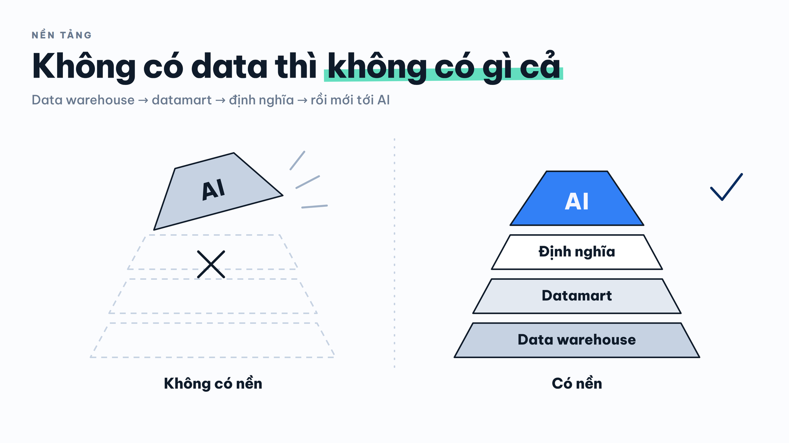
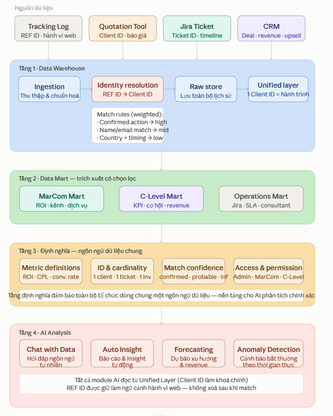

Marcoms MSD 2026 > Dự án Đồng bộ hệ thống_Data Sync - 05.2026 > [Data mart Quotation-Jira-CRM_Data Sync_17/6/2026](Data%20mart%20Quotation-Jira-CRM_Data%20Sync_17_6_2026.md)

# \[Propose\] Phát triển GLAC Data IQ - Data Mart - 19.08.2026

|          |                         |
|:---------|:------------------------|
| Preparer | Ivy Nguyen              |
| Reporter | Chị Hong Anh Daniel Bui |
| Date     | 2026-08-19              |

- [1. Bối cảnh & vấn đề hiện tại](#id-proposepháttriểnglacdataiq-datamart-19082026-1bốicảnhvấnđềhiệntại)
  - [1.1. Dữ liệu phi tập trung](#id-proposepháttriểnglacdataiq-datamart-19082026-11dữliệuphitậptrung)
  - [1.2. Các dữ liệu không có sự kết nối](#id-proposepháttriểnglacdataiq-datamart-19082026-12cácdữliệukhôngcósựkếtnối)
  - [1.3. Dữ liệu thiếu định nghĩa thống nhất](#id-proposepháttriểnglacdataiq-datamart-19082026-13dữliệuthiếuđịnhnghĩathốngnhất)
  - [1.4. Dữ liệu có nhưng không tận dụng chuyên gia AI để phân tích](#id-proposepháttriểnglacdataiq-datamart-19082026-14dữliệucónhưngkhôngtậndụngchuyêngiaaiđểphântích)
- [2. Đề xuất GLAC Data IQ](#id-proposepháttriểnglacdataiq-datamart-19082026-2đềxuấtglacdataiq)
- [3. Giai đoạn phát triển dự án](#id-proposepháttriểnglacdataiq-datamart-19082026-3giaiđoạnpháttriểndựán)

## 1. Bối cảnh & vấn đề hiện tại

### 1.1. Dữ liệu phi tập trung

GLAC đã và đang vận hành được 4 công cụ (Website Tracking Log → Quotation Tool → Jira Ticket → CRM) ghi nhận hành trình khách hàng từ Traffic → MQL → SQL → Client. Tuy nhiên, dữ liệu của 4 công cụ đang nằm riêng biệt tại chính mỗi công cụ.

⚠️ **Các bất cập khi dữ liệu nằm phi tập trung:**

- Cần IT xuất dữ liệu ở từng công cụ theo mô tả của người yêu cầu → mất thời gian nếu có miscommunication;
- Data engineer vào xử lý dữ liệu từ các file rời rạc.

> [!TIP]
> Cần một Single source of Truth, đó là Data Warehouse để tập trung dữ liệu

### 1.2. Các dữ liệu không có sự kết nối

Dù 4 công cụ đều ghi nhận thông tin khách hàng, nhưng các công cụ không có chất xúc tác để “nói chuyện” được với nhau. Ví dụ: Một khách hàng truy cập website, gửi báo giá, ký hợp đồng và được lập invoice, nhưng hành trình đó bị gián đoạn hoàn toàn giữa các công cụ vì không có khoá chung (PK - Primary Key) để liên kết.

Thực tế ở 4 công cụ của GLAC:

- REF ID từ Tracking Log cần được map với Client ID từ Quotation Tool;
- Client ID từ Quotation Tool cần tự động xuất hiện trong Jira hay CRM (hiện tại tự động từ QT lên Jira, nhưng chưa tự động từ Jira lên CRM).

⚠️ **Các bất cập khi dữ liệu không có sự kết nối:**

- Không thể biết một khách hàng đã ký hợp đồng đến từ kênh marketing nào, chiến dịch nào, trang nào trên website, chủ yếu do Consultant suy đoán nếu khách không cung cấp thông tin --> MarCom không đo được ROI thực sự theo từng kênh
- Không thể trả lời câu hỏi “từ lúc khách vào website đến khi ký hợp đồng mất bao lâu?” vì không có điểm nối giữa Tracking Log và Quotation Tool
- Báo cáo tổng hợp phải ghép thủ công từ nhiều file export --> dễ sai lệch, mất thời gian, không realtime
- C-level có thể nhanh chóng tìm được các điểm nghẽn trong kinh doanh và vận hành (ví dụ số lượng báo giá gửi ra nhiều nhưng ticket Jira thấp, có data history để đối chiếu qua các năm)

> [!TIP]
> Cần **Data Mart** — lớp dữ liệu trích xuất có chọn lọc và kết nối theo hành trình khách hàng, phục vụ từng nhóm người dùng (MarCom, C-Level, Consulting) với góc nhìn phù hợp với từng vai trò

### 1.3. Dữ liệu thiếu định nghĩa thống nhất

Khi dữ liệu được tổng hợp, một vấn đề khác xuất hiện: cùng một chỉ số nhưng mỗi người hiểu và tính theo một cách khác nhau.

**Các bất cập khi thiếu định nghĩa thống nhất:**

- Các team báo cáo cùng một chỉ số nhưng ra con số khác nhau → mất thời gian đối chiếu, mất niềm tin vào dữ liệu
- Khi nhân sự mới vào hoặc người phụ trách thay đổi, cách tính metric bị thay đổi theo → dữ liệu lịch sử không còn so sánh được
- Garbage in, garbage out: AI và các công cụ phân tích tự động sẽ cho ra kết quả sai nếu metric đầu vào không được định nghĩa rõ ràng

> [!TIP]
> Cần một lớp **Data Dictionary & Định nghĩa metric**, tài liệu được tích hợp trực tiếp vào platform, định nghĩa rõ từng chỉ số được tính như thế nào, từ nguồn nào, theo logic gì, v.v. để toàn bộ người xem dữ liệu dùng chung một ngôn ngữ dữ liệu

### 1.4. Dữ liệu có nhưng không tận dụng chuyên gia AI để phân tích

Ngay cả khi dữ liệu đã được tập trung, kết nối và định nghĩa rõ ràng, giá trị thực sự của dữ liệu chỉ được khai thác khi có người hoặc công cụ đủ năng lực và đủ hiểu kinh doanh và cách vận hành của công ty để có thể phân tích các dữ liệu.

Ví dụ, để trả lời một câu hỏi kinh doanh như “kênh nào ngoại trừ website đang mang về khách hàng có giá trị vòng đời cao nhất?” hay “dịch vụ nào nên đẩy mạnh tại thị trường Singapore trong quý tới?”, GLAC cần một người vừa hiểu nghiệp vụ, vừa biết truy vấn dữ liệu, vừa có thời gian tổng hợp — một năng lực hiếm và tốn kém nếu phải thuê riêng.

**Các bất cập khi chưa tận dụng AI trong phân tích:**

- Insight từ dữ liệu phụ thuộc hoàn toàn vào năng lực và thời gian của con người — không scalable khi khối lượng dữ liệu tăng
- Các câu hỏi ad-hoc ("tuần này có bao nhiêu quotation từ Singapore chưa ra ticket?") phải chờ IT hoặc Data team xử lý thay vì được trả lời ngay lập tức
- Không có cơ chế tự động phát hiện và cảnh báo các bất thường trong dữ liệu theo thời gian thực
- Người dùng non-technical (C-Level, MarCom) bị rào cản bởi giao diện dashboard, chỉ xem được những gì đã được thiết kế sẵn, không thể đặt câu hỏi mới

Trong khi đó, các mô hình AI của GLAC ngày càng hoàn thiện, có thể đạt đến mức có thể đóng vai trò như một chuyên gia phân tích dữ liệu. AI có thể hiểu ngữ cảnh, suy luận đa chiều, và trả lời bằng ngôn ngữ tự nhiên, đặc biệt là bảo mật dữ liệu.

> [!TIP]
> Cần tích hợp **AI hỏi & đáp trực tiếp trong GLAC Dataa IQ** để AI đóng vai trò như một chuyên gia phân tích dữ liệu nội bộ

## 2. Đề xuất GLAC Data IQ

GLAC Data IQ (GLAC Data Intelligence & Query) là internal platform tích hợp 4 tầng:

**Demo giao diện GLAC Data IQ**

📎 *Tệp đính kèm **GLAC IQ v3 - Google Chrome 2026-08-19 16-19-42.mp4** (65.4 MB) quá lớn nên không được đưa lên GitHub — xem tệp này tại [trang gốc trên Confluence](https://globallinkasiaconsulting.atlassian.net/wiki/spaces/MSD/pages/5537988668).*

## 3. Giai đoạn phát triển dự án

|  | <mark style="background: #abf5d1;">**Giai đoạn**</mark> | <mark style="background: #abf5d1;">**Mục tiêu**</mark> |
| --- | --- | --- |
| 1 | <mark style="background: #e3fcef;">**Giai đoạn 1: 2-3 tuần**</mark> | <mark style="background: #e3fcef;">**Giai đoạn 1: 2-3 tuần**</mark> |
| 2 | **Tầng 1: Data warehouse** | Tập hợp toàn bộ dữ liệu cần thiết về cùng một nguồn; Có dữ liệu sạch và kết nối được. |
| 3 | **Tầng 2: Data Mart và Dashboard** | Thống nhất các dashboard hiển thị tại Data Mart các dashboard hiển thị trên cho các vai trò:  - MarCom  - C-level  - Consulting |
| 4 | **Tầng 3: Định nghĩa** | Tài liệu được tích hợp trực tiếp vào platform, định nghĩa rõ từng chỉ số được tính như thế nào, từ nguồn nào, theo logic gì, v.v. để toàn bộ người xem dữ liệu dùng chung một ngôn ngữ dữ liệu |
| 5 | <mark style="background: #e3fcef;">**Giai đoạn 2: 3-4 tuần**</mark> | <mark style="background: #e3fcef;">**Giai đoạn 2: 3-4 tuần**</mark> |
| 6 | **Tầng 4: AI Analysis** | Từ reporting sang insight tự động. Người dùng được phân quyền có thể:  - Chat với Data  - Auto insight  - Dự đoán |
